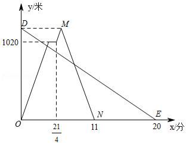

# Mathematics - 题目 820

**ID**: f99368f216da4fa4953e3526f43bf668
**年级**: Grade 9
**难度**: Medium-Hard
**题型**: Calculation

## 题目
在一条笔直的公路上依次有A，C，B三地，甲、乙两人同时出发，甲从A地骑自行车去B地，途经C地休息1分钟，继续按原速骑行至B地，甲到达B地后，立即按原路原速返回A地；​​​​​​​‌乙步行从B地前往A地．甲、乙两人距A地的路程y（米）与时间x（分）之间的函数关系如图所示，请结合图象解答下列问题：（1）请写出甲的骑行速度为米/分，点M的坐标为；（2）求甲返回时距A地的路程y与时间x之间的函数关系式（不需要写出自变量的取值范围）；（3）请直接写出两人出发后，在甲返回A地之前，经过多长时间两人距C地的路程相等．

## 解答

1. （1）由题意得：甲的骑行速度为：=240（米/分），
2. 240×（11﹣1）÷2=1200（米），
3. 则点M的坐标为（6，1200），
4. 故答案为240，（6，1200）；
5. （2）设MN的解析式为：y=kx+b（k≠0），
6. ∵y=kx+b（k≠0）的图象过点M（6，1200）、N（11，0），
7. ∴，
8. 解得，
9. ∴直线MN的解析式为：y=﹣240x+2640；
10. 即甲返回时距A地的路程y与时间x之间的函数关系式：y=﹣240x+2640；
11. （3）设甲返回A地之前，经过x分两人距C地的路程相等，
12. 乙的速度：1200÷20=60（米/分），
13. 
14. 如图1所示：∵AB=1200，AC=1020，
15. ∴BC=1200﹣1020=180，
16. 分5种情况：
17. ①当0＜x⩽3时，1020﹣240x=180﹣60x，
18. x=＞3，
19. 此种情况不符合题意；
20. ②当3＜x＜﹣1时，即3＜x＜，甲、乙都在A、C之间，
21. ∴1020﹣240x=60x﹣180，
22. x=4，
23. ③当＜x⩽6时，甲在B、C之间，乙在A、C之间，
24. ∴240x﹣1020=60x﹣180，
25. x=＜，
26. 此种情况不符合题意；
27. ④当x=6时，甲到B地，距离C地180米，
28. 乙距C地的距离：6×60﹣180=180（米），
29. 即x=6时两人距C地的路程相等，
30. ⑤当x＞6时，甲在返回途中，
31. 当甲在B、C之间时，180﹣[240（x﹣1）﹣1200]=60x﹣180，x=6，
32. 此种情况不符合题意，
33. 当甲在A、C之间时，240（x﹣1）﹣1200﹣180=60x﹣180，
34. x=8，
35. 综上所述，在甲返回A地之前，经过4分钟或6分钟或8分钟时两人距C地的路程相等．

## 知识点

**中文**:
  - 一次函数与二元一次方程（组）
  - 行程问题
  - 待定系数法求一次函数解析式

**English**:
  - Linear Functions and Systems of Linear Equations
  - Distance-Speed-Time Problems
  - Finding Expressions by Undetermined Coefficients

---
