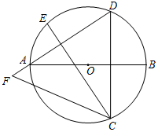

# Mathematics - 题目 358

**ID**: fa0e6c8316c94fba859b670ecea72c2b
**年级**: Grade 9
**难度**: Medium-Hard
**题型**: Calculation

## 题目
如图，AB是⊙O的直径，弦CD⊥AB，点E是 $\overset ⌢{{AB}}$ 上一点，点D关于CE的对称点F恰好落在DA的延长线上，连结CF．（1）求证：∠BAD＝∠ECF．（2）若tan∠BAD＝ $\frac {2}{3}$ ，AF＝9，求⊙O的半径．​​​​​​​‌

## 解答

1. 解：（1）连接 $BD$ ，如下图：
2. 
3. ∵AB是⊙O的直径
4. ∴ $\angle ADB=90{}^\circ $ ，即 $DB⊥DF$
5. ∵点D与点F关于CE的对称
6. ∴ $DF\bot CE$ ， $\angle ECF=\angle DCE$
7. ∴ $CE//DB$
8. ∴ $\angle DCE=\angle BDC$
9. ∵AB是⊙O的直径，弦CD⊥AB
10. ∴ $\overset ⌢{{BC}}=\overset ⌢{{BD}}$
11. ∴ $\angle BDC=\angle BAD$
12. ∴ $\angle ECF=\angle BAD$
13. （2）设 $AD$ 与 $CE$ 的交点为 $M$ ， $CD$ 与 $AB$ 的交点为 $N$ ，如下图：
14. 
15. 设 $BD=2x$ ，
16. ∵ $\tan \angle BAD＝\frac {2}{3}$ ，
17. ∴ $AD=3x$ ， $DF=9+3x$
18. 由题意可得： $DM=\frac {1}{2}DF=\frac {9+3x}{2}$
19. 由（1）得 $\angle ADB=\angle BND=90{}^\circ $
20. ∴ $\angle BDN=\angle DAB$
21. ∴ ${\tan}\angle BDN=\frac {2}{3}$ ，即 $\frac {{\sin}\angle BDN}{{\cos}\angle BDN}=\frac {2}{3}$
22. 根据三角函数关系 ${\sin}{^{2}}\angle BDN+{\cos}{^{2}}\angle BDN=1$
23. 可得 ${\sin}\angle BDN=\frac {2\sqrt {13}}{13}$ ， ${\cos}\angle BDN=\frac {3\sqrt {13}}{13}$
24. ∴ $DN=BD\times {\cos}\angle BDN=\frac {6\sqrt {13}}{13}x$
25. 由（1）得： $CD=2DN=\frac {12\sqrt {13}}{13}x$ ， $\angle BDN=\angle DCE$
26. ∴ ${\sin}\angle DCE=\frac {DM}{CD}=\frac {2\sqrt {13}}{13}$ ，
27. 即 $\frac {\frac {9+3x}{2}}{\frac {12\sqrt {13}}{13}x}=\frac {2\sqrt {13}}{13}$ ，解得 $x=13$
28. ∴ $BD=26,AD=39$
29. 由勾股定理得： $AB=\sqrt {AD{^{2}}+BD{^{2}}}=13\sqrt {13}$
30. ∴ $OA=\frac {1}{2}AB=\frac {13\sqrt {13}}{2}$ ，即半径为 $\frac {13\sqrt {13}}{2}$

## 知识点

**中文**:
  - 垂径定理的应用

**English**:
  - Applications of Perpendicular Chord Theorem

---
