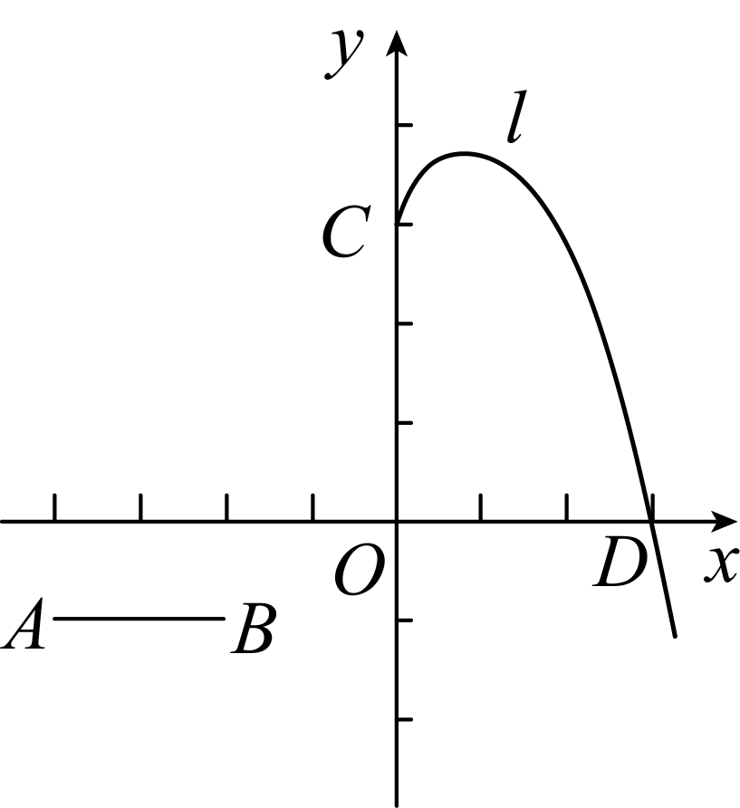

# Mathematics - 题目 2789

**ID**: fa3074eebd9f4561a6e8f870fea7e33a
**年级**: Grade 9
**难度**: Medium-Hard
**题型**: Calculation

## 题目
如图，点，，线段与轴平行，且，点在点的右侧，抛物线．(1)①该抛物线的对称轴为；​​​​​​​‌②当时，求的最大值（用含的代数式表示）．(2)当抛物线经过点时①点（填“是”或“不”）在上；②连接，点是第一象限内抛物线上的动点，设点的横坐标为，过点作，垂足为点，则时，．(3)在（2）的条件下，若线段以每秒2个单位长的速度向下平移，设平移的时间为（秒）①若与线段总有公共点，求的取值范围；②若同时以每秒3个单位长的速度向下平移，在轴及其右侧的图象与直线总有两个公共点，直接写出的取值范围．

## 解答

1. （1）①该抛物线的对称轴为直线；
2. ②∵，
3. ∴当时，有最大值，；
4. 当时，时，有最大值，；
5. （2）①当抛物线经过点时，，，
6. ∴抛物线的解析式为，顶点坐标，
7. ∵，线段与轴平行，且，
8. ∴，
9. 将代入，，
10. ∴点不在上，
11. 故答案为：不；
12. ②如图，过点做轴于点，与交于点．
13. 
14. ∵为等腰直角三角形，
15. ∴．
16. ∵，，
17. ∴．
18. ∵，
19. ∴．
20. 求得的表达式为，，，
21. ∴，
22. 解得或2
23. （3）①设平移后，，
24. 当抛物线经过点时，有，
25. 当抛物线经过点时，有，
26. ∵与线段总有公共点，
27. ∴，解得；
28. ②平移过程中，设，则抛物线的顶点，
29. ∵抛物线在轴及其右侧的图象与直线总有两个公共点，
30. ，解得．
31. 【点睛】此题主要考查了二次函数综合以及不等式组的解法等知识，正确利用数形结合分析得出关于t的不等式是解题关键．

## 知识点

**中文**:
  - 二次函数与不等式（组）
  - 二次函数的综合
  - 二次函数的对称

**English**:
  - Quadratic Functions and Inequalities
  - Comprehensive Quadratic Function Problems
  - Symmetry of Quadratic Functions

---
