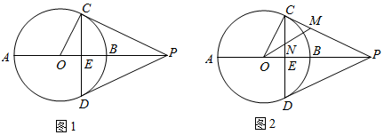

# Mathematics - 题目 2286

**ID**: fae4edce52a04635a02cff93dbffdb1f
**年级**: Grade 9
**难度**: Medium-Hard
**题型**: 解答题：本题共6小题，共48分。解答应写出文字说明，证明过程或演算步骤。

## 题目
如图 $1$ ， $AB$ 为 $\odot O$ 的直径， $P$ 为 $AB$ 延长线上的点， $PD$ 为 $\odot O$ 的切线，切点为 $D$ ， $CD\perp AB$ ，垂足为 $E$ ， $C$ 在 $\odot O$ 上，连接 $CO$ ， $PC$ ．$(1)$ 求证： $PC$ 为 $\odot O$ 的切线；​​​​​​​‌$(2)$ 如图 $2$ ， $M$ 是线段 $PC$ 上一点，若 $OM$ 平分 $\angle COP$ ， $OM$ 与线段 $CE$ 交于点 $N$ ．$①$ 求证： $△OMP{\rm ∽}$  $△ONC$ ；$②$ 若 $CM=10$ ， $MN=4\sqrt{5}$ ，求 $ON$ 的长．

## 解答

1. 证明： $(1)$ 连接 $OD$ ，如图 $1$ ，
2. 
3. $\because PD$ 为 $\odot O$ 切线，
4. $\therefore \angle ODP=90°$ ，
5. $\because AB\perp CD$ ，且 $AB$ 为 $\odot O$ 直径，
6. $\therefore AB$ 垂直平分 $CD$ ，
7. $\therefore PC=PD$ ，
8. $\therefore \angle PCD=\angle PDC$ ，
9. 又 $\because OC=OD$ ，
10. $\therefore \angle OCD=\angle ODC$ ，
11. $\therefore \angle OCP=\angle OCD+\angle PCD=\angle ODC+\angle PDC=90°$ ，
12. $\therefore OC\perp PC$ ，
13. $\therefore PC$ 为 $\odot O$ 的切线；
14. $(2)①\because AB\perp CD$ ，
15. $\therefore \angle CEP=90°$ ，
16. $\therefore \angle ECP+\angle MPO=90°$ ，
17. 又 $\angle OCD+\angle ECP=90°$ ，
18. $\therefore \angle MPO=\angle OCD$ ，
19. 又 $OM$ 平分 $\angle COP$ ，
20. $\therefore \angle CON=\angle MOP$ ，
21. $\therefore △OMP{\rm ∽}$  $△ONC$ ；
22. 解： $②$ 过 $C$ 作 $CG\perp OM$ 于 $G$ ，
23. 
24. $\because △OMP{\rm ∽}$  $△ONC$ ，
25. $\therefore \angle CNO=\angle OMP$ ，
26. $\because 180°-\angle CNO=180°-\angle OMP$ ，
27. $\therefore \angle CMO=\angle CNM$ ，
28. $\therefore CM=CN=10$ ，
29. $\because CG\perp MN$ ，
30. $\therefore NG=MG=2\sqrt{5}$ ，
31. $\therefore CG=\sqrt{C{M}^{2}-M{G}^{2}}=4\sqrt{5}$ ，
32. $\therefore \tan \angle CMN=\frac{CG}{MG}=\frac{4\sqrt{5}}{2\sqrt{5}}=2$ ，
33. 又在 $Rt△COM$ 中，
34. $\tan \angle CMN=\frac{OC}{CM}=2$ ，
35. $\therefore OC=2CM=20$ ，
36. $\therefore OM=\sqrt{O{C}^{2}+C{M}^{2}}=10\sqrt{5}$ ，
37. $\therefore ON-OM-MN=10\sqrt{5}-4\sqrt{5}=6\sqrt{5}$ ．

## 知识点

**中文**:
  - 90°的圆周角所对的弦是直径
  - 切线的判定定理
  - 相似三角形的判定与性质综合
  - 解直角三角形

**English**:
  - Chord of 90° Inscribed Angle is Diameter
  - Tangent Determination Theorem
  - Determination and Properties
  - Solving Right Triangles

---
