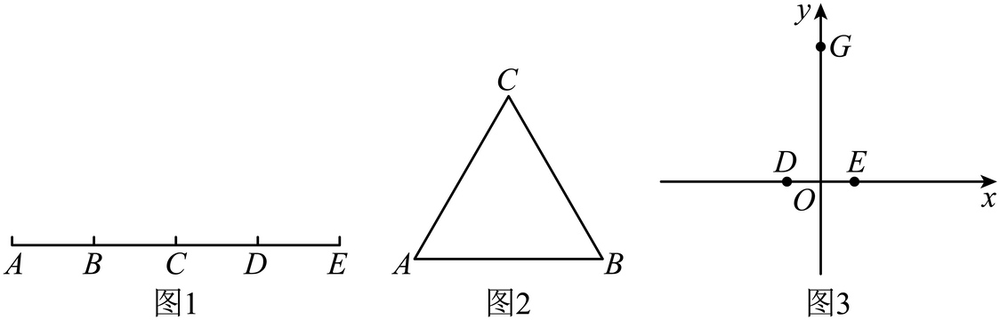

# Mathematics - 题目 1923

**ID**: faee3fc239b2451c8d1f7bffdf107526
**年级**: Grade 9
**难度**: Medium-Hard
**题型**: Calculation

## 题目
对于平面内有公共点的两个图形，若将其中一个图形沿着某个方向移动一定的距离d后与另一个图形重合，则称这两个图形存在“平移关联”，其中一个图形叫做另一个图形的“平移关联图形”．(1)如图1，B，C，D是线段AE的四等分点．若 $AE=4$ ，则在图中，线段AC的“平移关联图形”是， $d=$（写出符合条件的一种情况即可）；​​​​​​​‌(2)如图2，等边三角形 $ABC$ 的边长是2．用直尺和圆规作出 $\vartriangle ABC$ 的一个“平移关联图形”，且满足 $d=2$ （保留作图痕迹，不要求写作法）；(3)如图3，在平面直角坐标系 $xOy$ 中，点D，E，G的坐标分别是 $\left ({-1,0}\right )$ 、 $\left ({1,0}\right )$ 、 $\left ({0,4}\right )$ ，以点G为圆心，r为半径画圆．若对 $\odot G$ 上的任意点F，连接 $DE,EF,FD$ 所形成的图形都存在“平移关联图形”，且满足 $d\geqslant 3$ ，直接写出r的取值范围．

## 解答

1. （1）解：∵B，C，D是线段AE的四等分点 ${\rm ．}AE=4$ ，
2. ∴ $AB=BC=CD=DE=1$ ，∴ $AC=BD=CE=2$ ，
3. ∴线段 $AC$ 的平移图形是 $CE$ ， $d=2$ ；
4. （2）解：如图： $\mathrm{△}EBD$ 即为所求；
5. 
6. 由作图可知： $BE=CE=AB=AC,BC=BD=BE=CE$ ，
7. ∴四边形 $ABEC$ 为菱形，∴ $CE{\rm{/\mskip-4mu/}}AB$ ，
8. ∵ $BC=BD=CE$ ，∴四边形 $CBDE$ 为菱形，
9. ∴ $BD=DE=BE=AB=2$ ， ∴ $\mathrm{△}EBD$ 即为所求；
10. （3）∵点D，E，G的坐标分别是 $\left ({-1,0}\right )$ 、 $\left ({1,0}\right )$ 、 $\left ({0,4}\right )$ ，
11. ∴ $OD=OE=1,OG=4$ ，∴ $DE=2,DG=EG=\sqrt {1{^{2}}+4{^{2}}}=\sqrt {17}$ ，
12. ∵对 $\odot G$ 上的任意点F，连接 $DE,EF,FD$ 所形成的图形都存在“平移关联图形”，且满足 $d\geqslant 3$ ，且 $DE=2<3$ ，∴ $DF\geqslant 3,EF\geqslant 3$ ，
13. 当 $DE$ 在圆外时，
14. ∵ $DF\geqslant DG-GF$ ， $EF\geqslant EG-GF$ ，∴ $\sqrt {17}-GF\geqslant 3$ ，
15. ∴ $GF\leqslant \sqrt {17}-3$ ，∴ $0<r\leqslant \sqrt {17}-3$ ．
16. 
17. 当 $DE$ 在圆内时，则 $GF-\sqrt {17}\geqslant 3$ ，∴ $GF-\sqrt {17}\geqslant 3$ ，∴ $r\geqslant 3+\sqrt {17}$ ；
18. 
19. 综上， $0<r\leqslant \sqrt {17}-3$ 或 $r\geqslant 3+\sqrt {17}$ ．

## 知识点

**中文**:
  - 几何变换——平移综合题
  - 勾股定理
  - 菱形的判定与性质综合
  - 直线和圆的位置关系

**English**:
  - Translation Comprehensive Problems
  - Pythagorean Theorem
  - Determination and Properties of Rhombuses
  - Line and Circle Relationship

---
