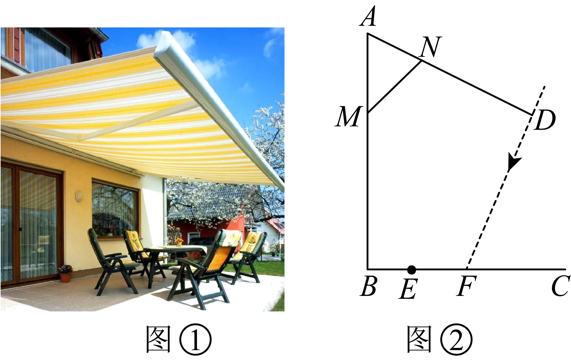
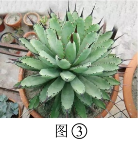

# Mathematics - 题目 991

**ID**: fb4f144cfdd34e6eac3a605c75ee5082
**年级**: Grade 9
**难度**: Medium-Hard
**题型**: Calculation

## 题目
根据以下素材，探索完成任务．素材1图①是宁宁家安装的户外遮阳篷．图②是其侧面示意图，已知该遮阳篷安装在垂直于地面BC的墙面上，篷面安装点A离地面4米，篷面与墙面的夹角 $∠DAB=60{}\degree $ ，篷面宽 $AD=3$ 米．除此之外，为了保障遮阳篷的稳定性，还加装了支架MN稳定篷面．支架MN的安装方式如下：点M固定在墙面上，位于点A的正下方，即点A，M，B共线；点N固定在篷面上离A点1米处（点A，N，D共线），即 $AN=1$ 米，支架MN与墙面的夹角 $\angle AMN=45{}\degree $ ．素材2宁宁所在地区某天下午不同时间的太阳高度角 $α$ （太阳光线与地面的夹角）的正切值参照表：时刻12点13点14点15点角 $α$ 的正切值432.​​​​​​​‌52素材3宁宁养了一株龙舌兰（图③），该植物喜阳，所以宁宁经常把龙舌兰搬到能被太阳光照射到的地方，以保证龙舌兰有充足的光照，如图②，这株龙舌兰摆放的位置记为点E．任务1确定安装点请求出支架 $MN$ 的固定点M与A点的距离 $AM$ 的长．任务2确定影子长请求出这天13点时遮阳篷落在地面上影子的长度．任务3判断能否照射到这天14点，宁宁将龙舌兰摆放到点E处，为了保证龙舌兰能被太阳光照射到，请求出此时摆放点离墙角距离的取值范围．

## 解答

1. 解：任务1：如图，过 $N$ 作 $HN\bot AM$ 于 $H$ ，
2. ，
3. ∴ $\angle NHA=\angle NHM=90{}\degree $ ，
4. 又∵ $∠DAB=60{}\degree $ ， $\angle AMN=45{}\degree $ ，
5. ∴ $HN=AN\sin \angle DAB=1\times \frac {\sqrt {3}}{2}=\frac {\sqrt {3}}{2}$ （米），
6. $AH=AN{\cos}\angle DAB=1\times \frac {1}{2}=\frac {1}{2}$ （米），
7. $HM=\frac {HN}{{\tan}\angle AMN}=\frac {\sqrt {3}}{2}\div {\tan}45{}\degree =\frac {\sqrt {3}}{2}$ （米），
8. ∴ $AM=\frac {1}{2}+\frac {\sqrt {3}}{2}=\frac {1+\sqrt {3}}{2}$ （米），
9. 任务2：如解图2，过 $D$ 作 $DG\bot AB$ 于 $G$ ，过 $B$ 作 $DK⊥BC$ 于 $K$ ，
10. ，
11. 则 $\angle DGB=\angle DKB=\angle ABC=90{}\degree $ ，
12. $\therefore $ 四边形 $BKDG$ 为矩形，
13. $\therefore BG=DK$ ， $DG=BK$ ，
14. ∵ $AD=3$ 米， $∠DAB=60{}\degree $ ，
15. ∴ $DG=AG\sin \angle DAB=3\times \frac {\sqrt {3}}{2}=\frac {3\sqrt {3}}{2}$ （米），
16. $AG=AD{\cos}\angle DAB=3\times \frac {1}{2}=\frac {3}{2}$ （米），
17. $HM=\frac {HN}{{\tan}\angle AMN}=\frac {\sqrt {3}}{2}\div {\tan}45{}\degree =\frac {\sqrt {3}}{2}$ （米），
18. ∵由题意可知： $AB=4$ 米，
19. ∴ $BG=AB-AG=4-\frac {3}{2}=\frac {5}{2}$ （米）
20. ∴ $BG=DK=\frac {5}{2}$ （米）， $DG=BK=\frac {3\sqrt {3}}{2}$ （米），
21. ∵13点时，太阳高度角 $α=\angle DFK$ ，
22. ∴ ${\tan}\angle DFK={\tan}α=3$ ，
23. ∴ $FK=\frac {DK}{{\tan}\angle DFK}=\frac {5}{2}\div 3=\frac {5}{6}$ （米）
24. ∴13点时遮阳篷落在地面上影子的长度 $=BK-FK=\frac {3\sqrt {3}}{2}-\frac {5}{6}=\frac {9\sqrt {3}-5}{6}$ （米）
25. 任务3： 由表格可知，在12时 $-15$ 时，角 $α$ 的正切值逐渐减小，即 $\angle BEM$ 逐渐较小，
26. $\therefore $ 当14时，此时 $BE$ 的长度就是绿萝摆放位置与墙壁的最大距离，
27. 
28. 如解图3，在 ${\rm{R}}{\rm{t}}\vartriangle DEK$ 中， ${\rm{t}}{\rm{a}}{\rm{n}}\angle DEK=\frac {DK}{EK}$ ，
29. 即 $EK=\frac {DK}{{\tan}α}=\frac {\frac {5}{2}}{2.5}=1$ （米），
30. $\therefore BE=BK-EK=\frac {3\sqrt {3}}{2}-1=\frac {3\sqrt {3}-2}{2}$ （米），
31. 答：龙舌兰能被太阳光照射到，此时摆放点离墙角距离的大于 $\frac {3\sqrt {3}-2}{2}$ 米．

## 知识点

**中文**:
  - 矩形的判定与性质综合
  - 解直角三角形的实际应用

**English**:
  - Determination and Properties of Rectangles
  - Applications of Solving Right Triangles

---
