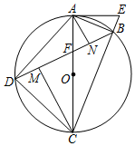

# Mathematics - 题目 1252

**ID**: fba125c6c3b54a039470fd3c5256ac32
**年级**: Grade 9
**难度**: Medium-Hard
**题型**: Calculation

## 题目
如图，四边形ABCD内接于⊙O，对角线AC、BD相交于点F，AC是⊙O的直径，延长CB到点E，连接AE，∠BAE＝∠ADB，AN⊥BD，CM⊥BD，垂足分别为点N、M．（1）证明：AE是⊙O的切线；​​​​​​​‌（2）试探究DM与BN的数量关系并证明；（3）若BD＝BC，MN＝2DM，当AE＝ $\sqrt {2}$ 时，求OF的长．

## 解答

1. 解：（1）证明： $\because AC$ 是 $\odot O$ 的直径，
2. $\therefore \angle ADC=90{}^\circ $ ，
3. $\therefore \angle ADB+\angle BDC=90{}^\circ $ ，
4. $\because \angle BAC=\angle BDC$ ， $\angle BAE=\angle ADB$ ，
5. $\therefore \angle BAE+\angle BAC=90{}^\circ $ ，即 $\angle CAE=90{}^\circ $ ，
6. $\therefore AE\bot AC$ ，
7. $AE$ 是 $\odot O$ 的切线；
8. （2）解： $DM=BN$ ，理由如下：
9. $\because AN\bot BD$ ， $CM\bot BD$ ， $\angle ADC=90{}^\circ $ ，
10. $\therefore \angle AND=\angle ANB=\angle DMC=\angle ADC=90{}^\circ $ ，
11. $\therefore \angle ADN+\angle MDC=\angle MCD+\angle MDC=90{}^\circ $ ，
12. $\therefore \angle ADN=\angle MCD$ ，
13. $\therefore ΔDMC∽ΔAND$ ，
14. $\therefore $  $\frac {DM}{AN}=\frac {CD}{AD}$ ，
15. $\because \angle ABN=\angle ACD$ ， $\angle ANB=\angle ADC=90{}^\circ $ ，
16. $\therefore ΔADC∽ΔANB$ ，
17. $\therefore $  $\frac {AD}{AN}=\frac {CD}{BN}$ ，即 $\frac {BN}{AN}=\frac {CD}{AD}$ ，
18. $\therefore $  $\frac {DM}{AN}=\frac {BN}{AN}$ ，
19. $\therefore DM=BN$ ；
20. （3）解：由（2）知 $DM=BN$ ，则 $BM=DN$ ，
21. 设 $DM=BN=a$ ，
22. $\because MN=2DM$ ， $BD=BC$ ，
23. $\therefore MN=2a$ ， $BM=DN=3a$ ， $BD=BC=4a$ ，
24. $\because \angle BMC=90{}^\circ $ ，
25. $\therefore CM=\sqrt {BC{^{2}}-BM{^{2}}}=\sqrt {(4a){^{2}}-(3a){^{2}}}=\sqrt {7}a$ ，
26. $\because AC$ 是 $\odot O$ 的直径， $AN\bot BD$ ，
27. $\therefore \angle ABC=\angle AND=90{}^\circ $ ，
28. $\because \angle ADB=\angle ACB$ ，
29. $\therefore ΔADN∽ΔACB$ ，
30. $\therefore $  $\frac {AN}{AB}=\frac {DN}{BC}=\frac {3a}{4a}=\frac {3}{4}$ ，
31. 设 $AN=3b$ ， $AB=4b(b>0)$ ，
32. $\because \angle ANB=\angle ABC=90{}^\circ $ ， $BN=a$ ，
33. $\therefore AN{^{2}}+BN{^{2}}=AB{^{2}}$ ，即 $(3b){^{2}}+a{^{2}}=(4b){^{2}}$ ，
34. 解得： $b=\frac {\sqrt {7}}{7}a$ ，
35. $\therefore AN=\frac {3\sqrt {7}}{7}a$ ， $AB=\frac {4\sqrt {7}}{7}a$ ，
36. $\because BC=4a$ ，
37. $\therefore AC=\sqrt {AB{^{2}}+BC{^{2}}}=\sqrt {(\frac {4\sqrt {7}}{7}){^{2}}+(4a){^{2}}}=\frac {8\sqrt {14}}{7}a$ ，
38. $\therefore {\cos}\angle ACB={\cos}\angle ADB={\cos}\angle EAB=\frac {BC}{AC}=\frac {4a}{\frac {8\sqrt {14}}{7}a}=\frac {\sqrt {14}}{4}$ ，
39. $\because AE=\sqrt {2}$ ，
40. $\therefore AB=AE\times {\cos}\angle EAB=\sqrt {2}\times \frac {\sqrt {14}}{4}=\frac {\sqrt {7}}{2}=\frac {4\sqrt {7}}{7}a$ ，
41. $\therefore a=\frac {7}{8}$ ，
42. $\therefore AC=\sqrt {14}$ ，
43. $\therefore OC=\frac {1}{2}AC=\frac {\sqrt {14}}{2}$ ，
44. $\because \angle ANF=\angle CMF=90{}^\circ $ ， $\angle AFM=\angle MFC$ ，
45. $\therefore ΔANF∽ΔCMF$ ，
46. $\therefore $  $\frac {AF}{CF}=\frac {AN}{MC}=\frac {\frac {3\sqrt {7}}{7}a}{\sqrt {7}a}=\frac {3}{7}$ ，
47. $\therefore CF=\frac {7}{10}AC=\frac {7\sqrt {14}}{10}$ ，
48. $\therefore OF=CF-OC=\frac {7\sqrt {14}}{10}-\frac {\sqrt {14}}{2}=\frac {\sqrt {14}}{5}$ ．
49. 

## 知识点

**中文**:
  - 余弦
  - 圆的综合问题
  - 相似三角形的判定与性质综合

**English**:
  - Cosine
  - Comprehensive Circle Problems
  - Determination and Properties

---
