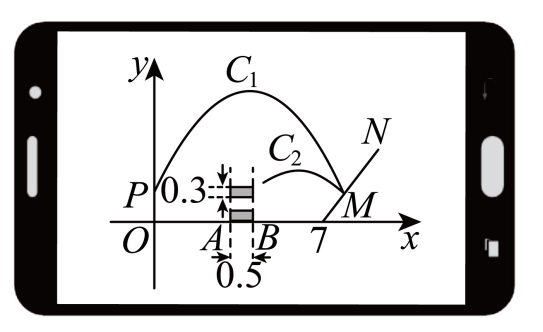

# Mathematics - 题目 1573

**ID**: fd7b7c8078cb4c97a462169e9a3b76f0
**年级**: Grade 9
**难度**: Medium-Hard
**题型**: Calculation

## 题目
嘉淇为了研究抛出的乒乓球落在斜面上反弹后的运动情况，用绘图软件在如图15所示的平面直角坐标系中进行模拟演示．当乒乓球 $($ 看成点 $)$ 以某种特定的角度和初速度从y轴上的点P处抛出后，乒乓球的运动路线是抛物线 $C{{}_{1}}$ ： $y=-\frac {1}{4}x{^{2}}+2x+1$ 的一部分．有一斜面 $MN$ ，乒乓球沿 $C{{}_{1}}$ 落到斜面 $MN$ 上经反弹后，继续沿抛物线 $C{{}_{2}}$ 运动．（1）求出点P及抛物线 $C{{}_{1}}$ 最高点的坐标；（2）若斜面 $MN$ 所在直线的解析式为 $y=x-7$ ，抛物线 $C{{}_{2}}$ 与 $C{{}_{1}}$ 的开口大小和方向均不变，但最大高度 $C{{}_{2}}$ 是 $C{{}_{1}}$ 的 $\frac {2}{5}$ ，求：①乒乓球与斜面 $MN$ 接触点的坐标；②抛物线 $C{{}_{2}}$ 的解析式．（3）嘉淇发现：“（2）中的抛物线 $C{{}_{2}}$ 可以通过 $C{{}_{1}}$ 平移得到．”请求出平移的最短路程；（4）在x轴上的线段 $AB$ 处竖直向上摆放着若干个无盖的长方体回收箱，已知 $OA=3.​​​​​​​‌5$ ，且每个回收箱的宽、高分别是 $0.5$ ， $0.3$ ．当（2）中沿抛物线 $C{{}_{2}}$ 下落的乒乓球能落入回收箱内（不含边缘）时，直接写出可竖直摆放的回收箱的个数．

## 解答

1. （1）解： $\because $ 点P在抛物线 $C{{}_{1}}$ 上，且在y轴上，
2. $\therefore $ 当 $x=0$ 时， $y=1$ ，
3. 即点P的坐标为 $\left ({0,1}\right )$ ，
4. $\because $ 抛物线 $C{{}_{1}}$ 的解析式为： $y=-\frac {1}{4}x{^{2}}+2x+1=-\frac {1}{4}(x-4){^{2}}+5$ ，
5. $\therefore $ 抛物线 $C{{}_{1}}$ 最高点的坐标为 $\left ({4,5}\right )$ ；
6. （2）①由题意，令 $x-7=-\frac {1}{4}x{^{2}}+2x+1$ ，
7. 整理得 $x{^{2}}-4x-32=0$ ，
8. 解得 $x{{}_{1}}=-4$ ， $x{{}_{2}}=8$ ，
9. $\because x>7$ ，
10. $\therefore x=8$ ，
11. 当 $x=8$ 时， $y=x-7=1$ ，
12. $\therefore $ 乒乓球与斜面 $MN$ 接触点的坐标为 $\left ({8,1}\right )$ ；
13. ②由题意得，抛物线 $C{{}_{2}}$ 的最大高度为 $5\times \frac {2}{5}=2$ ，
14. 设抛物线 $C{{}_{2}}$ 的解析式为 $y=-\frac {1}{4}(x-h){^{2}}+2$ ，
15. 把 $x=8$ ， $y=1$ 代入得 $1=-\frac {1}{4}(8-h){^{2}}+2$ ，
16. 解得 $h{{}_{1}}=10$ ， $h{{}_{2}}=6$ ，
17. $\because h<8$ ，
18. $\therefore h=6$ ，
19. $\therefore $ 抛物线 $C{{}_{2}}$ 的解析式为 $y=-\frac {1}{4}(x-6){^{2}}+2$ ；
20. （3） $\because C{{}_{1}}$ 的顶点为 $\left ({4,5}\right )$ ， $C{{}_{2}}$ 的顶点为 $\left ({6,2}\right )$ ，
21. $\therefore $ 可将抛物线 $C{{}_{1}}$ 向下平移3个单位长度，再向右平移2个单位长度得到 $C{{}_{2}}$ ，
22. $\therefore $ 平移的最短路程为 $\sqrt {3{^{2}}+2{^{2}}}=\sqrt {13}$ ；
23. （4） $\because OA=3.5$ ， $AB=0.5$ ，
24. $\therefore OB=4$ ，
25. 对于 $y=-\frac {1}{4}(x-6){^{2}}+2$ ，
26. 当 $x=3.5$ 时， $y=-\frac {1}{4}\times (3.5-6){^{2}}+2=0.4375$ ，
27. 当 $x=4$ 时， $y=-\frac {1}{4}\times (4-6){^{2}}+2=1$ ，
28. 设竖直摆放的回收箱有m个，
29. $\therefore 0.4375<0.3m<1$ ，
30. $\therefore 1.5<m<3.3$ ，
31. 答：竖直摆放的回收箱的个数为2个或3个．

## 知识点

**中文**:
  - 投球问题

**English**:
  - Projectile Problems

---
