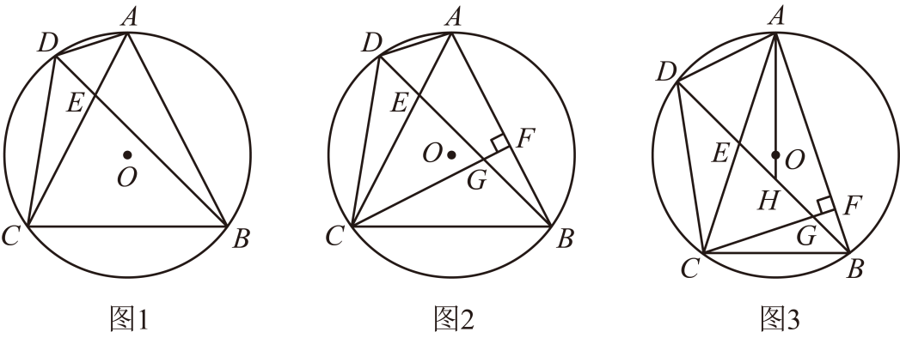

# Mathematics - 题目 3203

**ID**: fe636dbb4f984e128e0c7c446cd88789
**年级**: Grade 9
**难度**: Medium-Hard
**题型**: Calculation

## 题目
已知：四边形 $ABCD$ 为 $\odot O$ 的内接四边形， $BD$ 、 $AC$ 相交于点 $E$ ， $AB=AC$ ．(1)如图1，求证： $2\angle ADB+\angle CDB=180{}\degree $ ；​​​​​​​‌(2)如图2，过点 $C$ 作 $CF\bot AB$ 于点 $F$ ，交 $BD$ 于点 $G$ ，当 $\angle DBC=45{}\degree $ 时，求证： $CE=CG$ ；(3)如图3，在（2）的条件下，连接 $AO$ 并延长交 $BD$ 于点 $H$ ，当 $AE=CE=3$ 时，求 $CD$ 的长．

## 解答

1. （1）证明： $\because AB=AC$ ，
2. $\therefore \angle ACB=\angle ABC$ ，
3. $\because $ 四边形 $ABCD$ 为 $\odot O$ 的内接四边形，
4. $\therefore \angle ADC+\angle ABC=180{}\degree $ ，
5. $\because \angle ADB=\angle ACB$ ，
6. $\therefore \angle ADB=\angle ABC$ ，
7. $\because \angle ADC=\angle CDB+\angle ADB$ ，
8. $\therefore \angle ADC+\angle ABC=\angle CDB+\angle ADB+\angle ADB=\angle CDB+2\angle ADB=180{}\degree $ ，
9. $\therefore 2\angle ADB+\angle CDB=180{}\degree $ ；
10. （2）证明：过点 $C$ 作 $CN\bot DB$ 交 $BD$ 于点 $N$ ，交 $\odot O$ 于点 $M$ ，如图1，
11. 
12. $\because \angle DBC=45{}\degree $ ，
13. $\therefore \angle MCB=180{}\degree -\angle CNB-\angle DBC=45{}\degree $ ，
14. $\therefore \angle MCB=\angle DBC=45{}\degree $ ，
15. $\therefore $  $\overset{\frown}{{MB}}=\overset{\frown}{{DC}}$ ，
16. $\because AB=AC$ ，
17. $\therefore $  $\overset{\frown}{{AB}}=\overset{\frown}{{AC}}$ ，
18. $\therefore $  $\overset{\frown}{{AD}}=\overset{\frown}{{AM}}$ ，
19. $\therefore \angle ACM=\angle DBA$ ，
20. $\because \angle CNG=\angle GFB$ ， $∠NGC=∠FGB$ ，
21. $\therefore \angle NCG=180{}\degree -\angle CNG-\angle NGC=180{}\degree -\angle GFB-\angle FGB=\angle GBF=\angle ECN$ ，
22. 在 $\vartriangle CEN$ 与 $\vartriangle CGN$ 中，
23. $\begin{cases}\angle ENC=\angle GNC\\CN=CN\\\angle ECN=\angle GCN\end{cases}$ ，
24. $\therefore \vartriangle CEN≌\vartriangle CGN({\rm{A}}{\rm{S}}{\rm{A}})$ ，
25. $\therefore CE=CG$ ；
26. （3）解：如图2，在 $DE$ 上取 $EP=EH$ ，连接 $AP$ ， $OE$ ， $CH$ ，延长 $AO$ 交 $BC$ 于 $Q$ ，过 $O$ 作 $OM\bot AB$ 于 $M$ ，
27. 
28. $\because E$ 为 $AC$ 的中点，
29. $\therefore OE\bot AC$ ，
30. $\because AB=AC$ ，
31. $\therefore OE=OM$ ，
32. $\mathbf{∴}AQ$ 平分 $∠CAB$ ，
33. $\therefore AQ\bot BC$ ，
34. $\because CQ=BQ$ ，点 $H$ 在 $AQ$ 上，
35. $\therefore CH=BH$ ，
36. $\because \angle DBC=45{}\degree $ ，
37. $\therefore \angle HCB=\angle DBC=45{}\degree $ ，
38. $\therefore \angle CHB=180{}\degree -\angle HCB-\angle DBC=90{}\degree $ ，
39. $\therefore CH\bot BD$ ，
40. $\because CE=CG$ ，
41. $\therefore EH=GH$ ，
42. $\because $ 在 $DE$ 上取 $EP=EH$ ，
43. 则四边形 $APCH$ 为 $▱APCH$ ，
44. $\therefore AP\mathrm{/\mskip-4mu/}CH$ ， $AP=CH$ ， $\angle APH=90{}\degree $ ，
45. $\because \angle AHP=\angle BHQ=45{}\degree $ ，
46. 设 $PE=x$ ，
47. $\therefore AP=PH=2PE=2x$ ， $AH=\sqrt {2}PH=2\sqrt {2}x$ ，
48. $\because AH{^{2}}-PH{^{2}}=AE{^{2}}-PE{^{2}}$ ，
49. $\therefore 8x{^{2}}-4x{^{2}}=3{^{2}}-x{^{2}}{\rm ，3}$
50. 解得： $x=\frac {3\sqrt {5}}{5}$ ，
51. $\therefore PE=HE=\frac {3\sqrt {5}}{5}$ ，
52. $\therefore AP=PH=CH=BH=\frac {6\sqrt {5}}{5}$ ， $BE=\frac {9\sqrt {5}}{5}$ ，
53. $\therefore AH=\sqrt {2}PH=\frac {6\sqrt {10}}{5}$ ，
54. $\therefore HQ=\frac {\sqrt {2}}{2}BH=\frac {3\sqrt {10}}{5}$ ，
55. 在 ${\rm{R}}{\rm{t}}\vartriangle ABQ$ 中， $BQ=HQ=\frac {3\sqrt {10}}{5}$ ， $AQ=\frac {6\sqrt {10}}{5}+\frac {3\sqrt {10}}{5}=\frac {9\sqrt {10}}{5}$ ，
56. 
57. $\therefore AB=\sqrt {AQ{^{2}}+BQ{^{2}}}=6$ ，
58. $\because $ 弦 $AC$ 与 $BD$ 相交于 $E$ ，
59. $\therefore \vartriangle CDE∽\vartriangle BAE$ ，
60. $\therefore $  $\frac {CD}{AB}=\frac {CE}{BE}$ ，
61. $\therefore CD=\frac {AB\cdot CE}{BE}=\frac {6\times 3}{\frac {9\sqrt {5}}{5}}=2\sqrt {5}$ ．

## 知识点

**中文**:
  - 圆内接四边形
  - 圆周角定理及推论
  - 圆的综合问题
  - 相似三角形的判定与性质综合

**English**:
  - Cyclic Quadrilaterals
  - Inscribed Angle Theorem
  - Comprehensive Circle Problems
  - Determination and Properties

---
