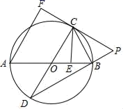

# Mathematics - 题目 2877

**ID**: fee11a4a3a474f608d69dc7dae17e7a7
**年级**: Grade 9
**难度**: Medium-Hard
**题型**: Calculation

## 题目
如图，AB是⊙O的直径，AB＝4 $\sqrt {3}$ ，点E为线段OB上一点（不与O，B重合），作CE⊥OB，交⊙O于点C，垂足为点E，作直径CD，过点C的切线交DB的延长线于点P，AF⊥PC于点F，连接CB．（1）求证：CB是∠ECP的平分线；​​​​​​​‌（2）求证：CF＝CE；（3）当 $\frac {CF}{CP}=\frac {3}{4}$ 时，求劣弧 $\overset ⌢{{BC}}$ 的长度（结果保留π）

## 解答

1. （1）证明：∵OC=OB，∴∠OCB=∠OBC，∵PF是⊙O的切线，CE⊥AB，∴∠OCP=∠CEB=90°，∴∠PCB+∠OCB=90°，∠BCE+∠OBC=90°，∴∠BCE=∠BCP，∴BC平分∠PCE．
2. （2）证明：连接AC．
3. ∵AB是直径，∴∠ACB=90°，∴∠BCP+∠ACF=90°，∠ACE+∠BCE=90°，∵∠BCP=∠BCE，∴∠ACF=∠ACE，∵∠F=∠AEC=90°，AC=AC，∴△ACF≌△ACE，∴CF=CE．
4. （3）解：作BM⊥PF于M．则CE=CM=CF，设CE=CM=CF=3a，PC=4a，PM=a，∵△BMC∽△PMB，∴ $\frac {BM}{PM}=\frac {CM}{BM}$ ，∴BM^{2}=CM•PM=3a^{2}，∴BM= $\sqrt {3}$a，∴tan∠BCM= $\frac {BM}{CM}=\frac {\sqrt {3}}{3}$ ，∴∠BCM=30°，∴∠OCB=∠OBC=∠BOC=60°，∴ $\overset ⌢{{BC}}$ 的长= $\frac {60π\times 2\sqrt {3}}{180}$  = $\frac {2\sqrt {3}}{3}π$ ．
5. 

## 知识点

**中文**:
  - 全等三角形的性质
  - 斜边直角边(HL)
  - 圆的综合问题
  - 弧长公式
  - 相似三角形的判定与性质综合

**English**:
  - Properties of Congruent Triangles
  - HL (Hypotenuse-Leg)
  - Comprehensive Circle Problems
  - Arc Length Formula
  - Determination and Properties

---
