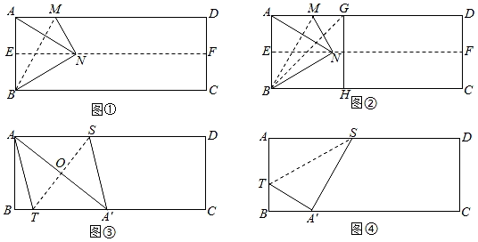

# Mathematics - 题目 1220

**ID**: ff30e3519f0e4360b6493bdbf843384d
**年级**: Grade 9
**难度**: Medium-Hard
**题型**: Calculation

## 题目
综合与实践在线上教学中，教师和学生都学习到了新知识，掌握了许多新技能．例如教材八年级下册的数学活动﹣﹣折纸，就引起了许多同学的兴趣．在经历图形变换的过程中，进一步发展了同学们的空间观念，积累了数学活动经验．实践发现：对折矩形纸片ABCD，使AD与BC重合，得到折痕EF，把纸片展平；​​​​​​​‌再一次折叠纸片，使点A落在EF上的点N处，并使折痕经过点B，得到折痕BM，把纸片展平，连接AN，如图①．（1）折痕BM（填“是”或“不是”）线段AN的垂直平分线；请判断图中△ABN是什么特殊三角形？答：；进一步计算出∠MNE＝°；（2）继续折叠纸片，使点A落在BC边上的点H处，并使折痕经过点B，得到折痕BG，把纸片展平，如图②，则∠GBN＝°；拓展延伸：（3）如图③，折叠矩形纸片ABCD，使点A落在BC边上的点A'处，并且折痕交BC边于点T，交AD边于点S，把纸片展平，连接AA'交ST于点O，连接AT．求证：四边形SATA'是菱形．解决问题：（4）如图④，矩形纸片ABCD中，AB＝10，AD＝26，折叠纸片，使点A落在BC边上的点A'处，并且折痕交AB边于点T，交AD边于点S，把纸片展平．同学们小组讨论后，得出线段AT的长度有4，5，7，9．请写出以上4个数值中你认为正确的数值．

## 解答

1. 解：（1）如图①∵对折矩形纸片ABCD，使AD与BC重合，
2. ∴EF垂直平分AB，
3. ∴AN＝BN，AE＝BE，∠NEA＝90°，
4. ∵再一次折叠纸片，使点A落在EF上的点N处，
5. ∴BM垂直平分AN，∠BAM＝∠BNM＝90°，
6. ∴AB＝BN，
7. ∴AB＝AN＝BN，
8. ∴△ABN是等边三角形，
9. ∴∠EBN＝60°，
10. ∴∠ENB＝30°，
11. ∴∠MNE＝60°，
12. 故答案为：是，等边三角形，60；
13. （2）∵折叠纸片，使点A落在BC边上的点H处，
14. ∴∠ABG＝∠HBG＝45°，
15. ∴∠GBN＝∠ABN﹣∠ABG＝15°，
16. 故答案为：15°；
17. （3）∵折叠矩形纸片ABCD，使点A落在BC边上的点A'处，
18. ∴ST垂直平分AA'，
19. ∴AO＝A'O，AA'⊥ST，
20. ∵AD∥BC，
21. ∴∠SAO＝∠TA'O，∠ASO＝∠A'TO，
22. ∴△ASO≌△A'TO（AAS）
23. ∴SO＝TO，
24. ∴四边形ASA'T是平行四边形，
25. 又∵AA'⊥ST，
26. ∴边形SATA'是菱形；
27. （4）∵折叠纸片，使点A落在BC边上的点A'处，
28. ∴AT＝A'T，
29. 在Rt△A'TB中，A'T＞BT，
30. ∴AT＞10﹣AT，
31. ∴AT＞5，
32. ∵点T在AB上，
33. ∴当点T与点B重合时，AT有最大值为10，
34. ∴5＜AT⩽10，
35. ∴正确的数值为7，9，
36. 故答案为：7，9．

## 知识点

**中文**:
  - 矩形的判定与性质综合
  - 等边三角形的判定与性质
  - 菱形的判定与性质综合

**English**:
  - Determination and Properties of Rectangles
  - Determination and Properties
  - Determination and Properties of Rhombuses

---
