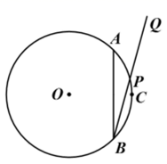

# Mathematics - 题目 908

**ID**: 030da8a088724a60a68f2790650a8b1b
**年级**: Grade 9
**难度**: Medium-Hard
**题型**: Fill-in-the-blank

## 题目
如图，⊙O的半径为1，弦 $AB=\sqrt {2}$ ， $\overset ⌢{{AC}}=\overset ⌢{{BC}}$ ，点 $P$ 为劣弧 $AC$ 上一个动点，延长 $BP$ 至点 $Q$ ，使 $BP\cdot BQ=AB{^{2}}$ ，当点 $P$ 由点 $A$ 运动到点 $C$ 时，点 $Q$ 的运动路径长为．​​​​​​​‌

## 解答

1. 解：如图：
2. 
3. 连接 $AP，AQ$ ，
4. 当 $BP\cdot BQ=AB{^{2}}$ 时，
5. 即 $\frac {BP}{AB}=\frac {AB}{BQ}$ ，
6. ∵ $\angle B=\angle B$ ，
7. ∴ $\vartriangle BAP∽\vartriangle BQA$ ，
8. ∴ $\angle BAQ=\angle BPA$ ，
9. ∴点Q的路径是经过A点的线段 $AQ$ ，
10. ∴当点P在点C时，
11. ∵ ${\mathop {AC}\limits_{}^{�}}={\mathop {BC}\limits_{}^{�}}$ ，
12. ∴ $AC=BC$ ，
13. 即 $AP=PB$ ，
14. ∴ $AB=AQ$ ，
15. ∵ $AB=\sqrt {2}$ ，
16. ∴ $AQ=\sqrt {2}$ ，
17. ∴点 $Q$ 的运动路径长为 $\sqrt {2}$

## 知识点

**中文**:
  - 垂径定理的应用
  - 相似三角形的判定与性质综合

**English**:
  - Applications of Perpendicular Chord Theorem
  - Determination and Properties

---
