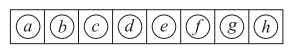

# Mathematics - 题目 3363

**ID**: 04821666d0df4126893c9c04c7db9eeb
**年级**: Grade 9
**难度**: Medium-Hard
**题型**: Fill-in-the-blank

## 题目
如图，在8个格子中依次放着分别写有字母a～h的小球．甲、乙两人轮流从中取走小球，规则如下：①每人首次取球时，只能取走2个或3个球；​​​​​​​‌后续每次可取走1个，2个或3个球；②取走2个或3个球时，必须从相邻的格子中取走；③最后一个将球取完的人获胜．（1）若甲首次取走写有b，c，d的3个球，接着乙首次也取走3个球，则（填“甲”或“乙”）一定获胜；（2）若甲首次取走写有a，b的2个球，乙想要一定获胜，则乙首次取球的方案是．

## 解答

1. 解：（1）∵甲首次取走写有b，c，d的3个球，
2. ∴还剩下a， $\cdots $ ，e，f，g，h，
3. 又∵乙首次也取走3个球，但必须相邻，
4. ∴乙可以取e，f，g或f，g，h，
5. 若乙取e，f，g，只剩下a， $\cdots $ ，h，
6. ∵它们不相邻，
7. ∴甲只能拿走一个，故乙拿走最后一个，故乙胜；
8. 同理，若乙取f，g，h，只剩下a， $\cdots $ ，e，
9. ∵它们不相邻，
10. ∴甲只能拿走一个，故乙拿走最后一个，故乙胜；
11. 枚答案为：乙；
12. （2）∵甲首次取走a，b二个球，还剩下c，d，e，f，g，h，
13. ①若乙取三个球:
14. 若乙取c，d，e或f，g，h，那么剩下的球是连着的，故若甲取走剩下的三个，则甲胜；
15. 若乙取d，e，f，此时甲取g，则c，h，不相邻，则甲胜；
16. 若乙取e，f，g，此时甲取d，则c，h，不相邻，则甲胜；
17. ②若乙取二个球:
18. 若乙取c，d，此时甲取f，g，那么剩下e，h，不相邻，则甲胜；
19. 若乙取d，e，此时甲取f，g，则c，h，不相邻，则甲胜；
20. 若乙取e，f，
21. 此时甲取c，d或g，h，则乙胜；
22. 若甲取c或d，那么乙取g或h，则乙胜；
23. 若甲取g或h，那么乙取c或d，那么剩下2个球不相邻，则乙胜；
24. 因此，乙一定要获胜，那么它首次取e，f，
25. 故答案为：e，f．
26. 【点睛】本题考查了逻辑推理，关键是明确最后一个将球取完的人获胜．

## 知识点

**中文**:
  - 归纳与类比

**English**:
  - Induction and Analogy

---
