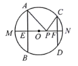

# Mathematics - 题目 3324

**ID**: 0832c8e2079b494384851c9a5448574e
**年级**: Grade 9
**难度**: Medium-Hard
**题型**: Fill-in-the-blank

## 题目
如图， $AB$ 、 $CD$ 是半径为5的 $\odot O$ 的两条弦， $AB=8$ ， $CD=6$ ， $MN$ 是直 径， $AB\bot MN$ 于点 $E$ ， $CD\bot MN$ 于点 $FPC$ ， $P$ 为 $EF$ 上的任意一点，则 $PA+PC$ 的最小值为.​​​​​​​‌

## 解答

1. 连接OA，OB，OC，作CH垂直于AB于H．
2. 
3. 根据垂径定理，得到BE=  $BE=\frac {1}{2}AB=4,CF=\frac {1}{2}CD=3$
4. $\therefore OE=\sqrt {OB{^{2}}-BE{^{2}}}=\sqrt {5{^{2}}-4{^{2}}}=3$
5. $OF=\sqrt {OC{^{2}}-CF{^{2}}}=\sqrt {5{^{2}}-3{^{2}}}=4$
6. ∴CH=OE+OF=3+4=7，
7. BH=BE+EH=BE+CF=4+3=7，
8. 在直角△BCH中根据勾股定理得到BC=7 $\sqrt {2}$ ，
9. 则PA+PC的最小值为7 $\sqrt {2}$ ．

## 知识点

**中文**:
  - 垂径定理的应用

**English**:
  - Applications of Perpendicular Chord Theorem

---
