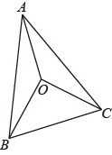

# Mathematics - 题目 527

**ID**: 0cbe9d1a20d94f3a8dd75805857c6bde
**年级**: Grade 9
**难度**: Medium-Hard
**题型**: Fill-in-the-blank

## 题目
如图，点O是三角形 $ABC$ 内的一点， $OA=OB=OC=4,\quad \angle BAC=45{}^\circ $ ，已知 $S{{}_{\vartriangle AOC}}-S{{}_{\vartriangle AOB}}=2$ ，则 $\angle BOC=$， $S{{}_{\vartriangle ABC}}=$．​​​​​​​‌

## 解答

1. 解：（1）∵OA=OB=OC=4，
2. ∴ $\vartriangle ABC$ 的外接圆的圆心为O，半径为4，如图所示．
3. 
4. $∵\overset ⌢{{BC}}=\overset ⌢{{BC}}\，$
5. $∴∠BOC=2∠BAC=2\times 45{^{\circ }}=90{^{\circ }}．$
6. 故答案为： $90{^{\circ }}$
7. （2）延长AO交 $\odot O$ 于点P，分别过点B、C作BM⊥AP于点M，CN⊥AP于点N，如图所示．
8. $∵S{{}_{△AOC}}-S{{}_{△AOB}}=2\，$
9. $∴\frac {1}{2}OA\centerdot CN-\frac {1}{2}OA\centerdot BM=2\．$
10. $∴\frac {1}{2}OA\left ({CN-BM}\right )=2\．$
11. $∵OA=4\，$
12. $∴CN-BM=1．$
13. $∵∠BOM{\rm{+}}∠CON=90{^{\circ }}，∠CON{\rm{+}}∠OCN=90{^{\circ }}，$
14. $∴∠BOM{\rm{=}}∠OCN\．$
15. 在 $\vartriangle BOM$ 和 $\vartriangle OCN$ 中，
16. $\begin{cases}\angle BOM{\rm{=}}\angle OCN\\\angle BMO{\rm{=}}\angle ONC=90{^{\circ }}\\OB=CO\end{cases}$
17. $∴△BOM\cong △OCN\left ({AAS}\right )．$
18. $∴OM=CN\．$
19. 在 $Rt\vartriangle OBM$ 中，
20. $∵BM{^{2}}+OM{^{2}}=OB{^{2}}=4{^{2}}=16\，$
21. $∴BM{^{2}}+CN{^{2}}=16\．$
22. ∵CN-BM=1，
23. ∴设BM=x，则CN=x+1．
24. $∴x{^{2}}+{\left({x+1}\right)^{2}}=16\．$
25. 整理得， $2x{^{2}}+2x-15=0\．$
26. 解得， $x{{}_{1}}=\frac {-1+\sqrt {31}}{2}，x{{}_{2}}=\frac {-1-\sqrt {31}}{2}\,$ （不合题意，舍去）
27. $∴x=\frac {-1+\sqrt {31}}{2}．$
28. $∴BM+CN=2x+1=2\times \frac {-1+\sqrt {31}}{2}+1=\sqrt {31}\．$
29. $∴S{{}_{△ABC}}=S{{}_{△AOC}}+S{{}_{△AOB}}+S{{}_{△BOC}}$
30. $=\frac {1}{2}OA\centerdot CN+\frac {1}{2}OA\centerdot BM+\frac {1}{2}OB\centerdot OC$
31. $=\frac {1}{2}OA\centerdot \left ({CN+BM}\right )+\frac {1}{2}OB\centerdot OC$
32. $=\frac {1}{2}\times 4\sqrt {31}+\frac {1}{2}\times 4\times 4$
33. $=2\sqrt {31}+8\．$
34. 故答案为： $2\sqrt {31}+8$

## 知识点

**中文**:
  - 三角形的外接圆
  - 勾股定理
  - 圆周角定理及推论

**English**:
  - Circumcircle of Triangle
  - Pythagorean Theorem
  - Inscribed Angle Theorem

---
