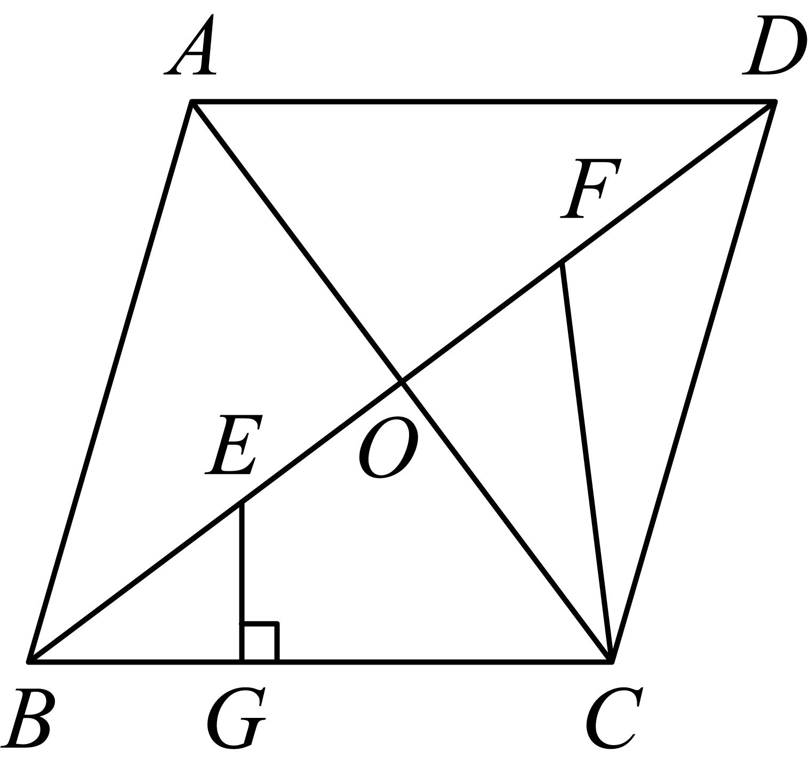

# Mathematics - 题目 476

**ID**: 0e3b8ac5c30d443b9a5b96664db358bb
**年级**: Grade 9
**难度**: Medium-Hard
**题型**: Fill-in-the-blank

## 题目
如图，在菱形 $ABCD$ 中，对角线 $AC$ 与 $BD$ 相交于点 $O$ ， $AC=6$ ， $BD=8$ ，点 $E$ ， $F$ 分别为 $OB$ ， $OD$ 上的点，且 $BE=DF$ ， $EG\bot BC$ 于点 $G$ ，连接 $CF$ ，若 $CF+EG=\frac {24}{5}$ ，则 $EF$ 的长为．​​​​​​​‌

## 解答

1. 解：连接 $AE$ 、 $CE$ 、 $AF$ 、 $AG$ ，
2. 
3. ∵四边形 $ABCD$ 是菱形，
4. ∴ $OB=OD$ ， $OA=OC$ ， $AC\bot BD$ ，
5. ∵ $AC=6$ ， $BD=8$ ，
6. ∴ $OB=OD=\frac {1}{2}BD=4$ ， $OA=OC=\frac {1}{2}AC=3$ ，
7. 在 $Rt\vartriangle BOC$ 中， $BC=\sqrt {OB{^{2}}+OC{^{2}}}=\sqrt {4{^{2}}+3{^{2}}}=5$ ，
8. ∵ $BE=DF$ ，
9. ∴ $OB-BE=OD-DF$ ，即 $OE=OF$ ，
10. 又∵ $OA=OC$ ， $AC\bot BD$ ，
11. ∴四边形 $AECF$ 是菱形，
12. ∴ $CF=AE$ ，
13. ∴ $EG+CF=EG+AE$ ，
14. 当 $\mathrm{A}$ 、 $E$ 、 $G$ 不共线时， $EG+AE>AG$ ，
15. 当 $\mathrm{A}$ 、 $E$ 、 $G$ 共线时，即 $AG\bot BC$ 时， $EG+CF=EG+AE=AG$ 最小，
16. ∴ $S{{}_{\vartriangle ABC}}=\frac {1}{2}BC·AG=\frac {1}{2}AC·OB$ ，
17. 即 $\frac {1}{2}\times 5\times AG=\frac {1}{2}\times 6\times 4$ ，
18. ∴ $AG=\frac {24}{5}$ ，
19. 在 $Rt\vartriangle ABG$ 中， $BG=\sqrt {AB{^{2}}-AG{^{2}}}=\sqrt {5{^{2}}-{\left({\frac {24}{5}}\right)^{2}}}=\frac {7}{5}$ ，
20. ∴ $\angle OBC=\angle OBC$ ， $\angle BGE=\angle BOC=90{}\degree $ ，
21. ∴ $\vartriangle BEG{\rm ∽}$  $\vartriangle BCO$ ，
22. ∴ $\frac {BG}{OB}=\frac {BE}{BC}$ ，
23. 即 $\frac {\frac {7}{5}}{4}=\frac {BE}{5}$ ，
24. ∴ $BE=\frac {7}{4}$ ，
25. ∴ $OE=OB-BE=4-\frac {7}{4}=\frac {9}{4}$ ，
26. ∴ $EF=2OE=\frac {9}{2}$ ．

## 知识点

**中文**:
  - 垂线段最短
  - 菱形的判定与性质综合
  - 相似三角形的判定与性质综合

**English**:
  - Shortest Perpendicular Segment
  - Determination and Properties of Rhombuses
  - Determination and Properties

---
