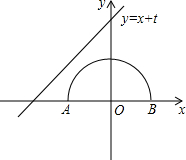

# Mathematics - 题目 51

**ID**: 10b9b1ba2b44486994ac5fae937e8539
**年级**: Grade 9
**难度**: Medium-Hard
**题型**: Fill-in-the-blank

## 题目
如图，半圆的圆心与坐标原点重合，半圆的半径为2，直线l的解析式为y＝x+t．若直线l与半圆只有一个交点，则t的取值范围是．​​​​​​​‌

## 解答

1. 解：根据题意可得：若直线l与半圆只有一个交点，则有两种情况：直线l和半圆相切于点 $C$ 或从直线l过点 $A$ 开始到直线l过点 $B$ 结束（不包括直线l过点 $A)$ ，
2. ∵直线l的解析式为y＝x+t，
3. ∴直线l与 $x$ 轴所形成的锐角是 $45{}^\circ $ ，
4. 过点C作CD⊥x轴于点D，则 $\angle CDO=90{}^\circ $ ．
5. 当直线l和半圆相切于点 $C$ 时，则 $OC$ 垂直于直线l， $\angle COD=45{}^\circ $ ，
6. ∴ $\mathrm{△}COD$ 为等腰直角三角形．
7. 又∵ $OC=2$ ，
8. ∴ $OD{^{2}}+CD{^{2}}=OC{^{2}}=4$ ，
9. ∴ $2OD{^{2}}=4$ ，
10. 解得： $OD=\sqrt {2}$ （舍负），
11. ∴ $CD=OD=\sqrt {2}$ ，
12. 即点 $C(-\sqrt {2}$ ， $\sqrt {2})$ ，
13. 把点 $C$ 的坐标代入直线解析式，得 $t=y-x=2\sqrt {2}$ ，
14. 当直线l过点 $A$ 时，把点 $A(-2,0)$ 代入直线解析式，得 $t=y-x=2$ ；
15. 当直线l过点 $B$ 时，把点 $B(2,0)$ 代入直线解析式，得 $t=y-x=-2$ ．
16. 即当 $t=2\sqrt {2}$ 或 $-2\mathrm{\leqslant }t<2$ 时，直线l和半圆只有一个公共点，
17. 故答案为： $t=2\sqrt {2}$ 或 $-2\mathrm{\leqslant }t<2$ ．
18. 

## 知识点

**中文**:
  - 直线和圆的位置关系

**English**:
  - Line and Circle Relationship

---
