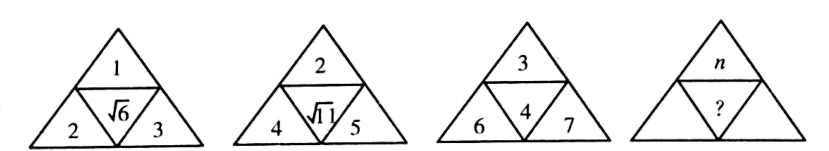

# Mathematics - 题目 883

**ID**: 14d01b69296c4819878fda00478e596b
**年级**: Grade 9
**难度**: Medium-Hard
**题型**: Fill-in-the-blank

## 题目
如图，下列每个三角形中的4个数之间都有相同的规律，根据这种规律，第n个三角形中间的数字用含n的代数式表示为．​​​​​​​‌

## 解答

1. 观察题图可得三角形中上角里面数字的规律为n，左下角里面数字的规律为2n，右下角里面数字的规律为2n+1，中间的数字的规律为三角形中三个角里面的数字和的算术平方根，
2. ∴第n个三角形中间的数字为 $\sqrt {n+2n+2n+1}=\sqrt {5n+1}$ ．
3. 故答案为： $\sqrt {5n+1}$ ．

## 知识点

**中文**:
  - 列代数式
  - 规律型：图形的变化类

**English**:
  - Writing Algebraic Expressions
  - Patterns: Geometric Variations

---
