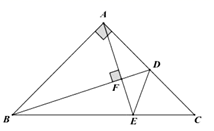

# Mathematics - 题目 2662

**ID**: 2405e3f9ed244113ac0527e21b420ac9
**年级**: Grade 9
**难度**: Medium-Hard
**题型**: Fill-in-the-blank

## 题目
如图， $\vartriangle BAC$ 中， $\angle BAC=90{}^\circ $ ， $AB=AC$ ，点D为 $AC$ 上一个动点，过A作 $AE\bot BD$ 交 $BC$ 于E，垂足为F．（1）当 $DE\bot BC$ 时，则 $\frac {BE}{CE}$ 的值为；​​​​​​​‌（2）当 $DE\bot AC$ 时，则 $\frac {BE}{CE}$ 的值为．

## 解答

1. 解：假定AB=AC=1，则BC= $\sqrt {2}$ ．
2. （1）当DE⊥BC时，如图：
3. 
4. ∵DE⊥BC，
5. ∴∠DEB=90°．
6. ∵∠BAC=90°，
7. 如图，取 $BD$ 的中点 $O,$  连接 $OA,OE,$
8. $\therefore OA=OB=OD=OE,$
9. ∴A，B，E，D四点在以 $O$ 为圆心， $OA$ 为半径的同一个圆上．
10. ∴∠BAE=∠BDE．
11. ∵DE⊥BC，
12. ∴∠BEF+∠DEF=90°．
13. ∵AE⊥BD，
14. ∴∠FDE+∠FED=90°．
15. ∴∠BEF=∠BDE
16. ∴∠BAE=∠BEA．
17. ∴AB=BE=1．
18. ∴EC=BC$\mathbf{-}$BE= $\sqrt {2}-1$ ．
19. ∴ $\frac {BE}{EC}=\frac {1}{\sqrt {2}-1}=\sqrt {2}+1$ ．
20. 故答案为： $\sqrt {2}+1$ ．
21. （2）如图：
22. 
23. ∵DE⊥AC，∠BAC=90°，
24. ∴DE∥AB．
25. ∴∠BAE=∠AED．
26. ∵∠BAC=90°，
27. ∴∠BAE+∠EAD=90°．
28. ∵AE⊥BD，
29. ∴∠EAD+∠ADB=90°．
30. ∴∠BAE=∠ADB．
31. ∴∠ADB=∠AED．
32. ∵∠BAD=∠ADE=90°，
33. ∴△ABD∽△DAE．
34. ∴ $\frac {AB}{AD}=\frac {AD}{DE}$ ．
35. ∵DE⊥AC，∠C=45°，
36. ∴DE=DC．
37. 设DE=DC=x，则AD=1 $\mathbf{-}$x，EC= $\sqrt {2}x$ ．
38. ∴BE=BC$\mathbf{-}$EC= $\sqrt {2}-\sqrt {2}x$ ．
39. ∴ $\frac {1}{1-x}=\frac {1-x}{x}$ ．
40. 解得：x_{1}＝ $\frac {3+\sqrt {5}}{2}$ (大于1，舍去)，x_{2}＝ $\frac {3-\sqrt {5}}{2}$ ．
41. 经检验： $x=\frac {3-\sqrt {5}}{2}$ 是原方程的根且符合题意，
42. ∴ $\frac {BE}{EC}=\frac {\sqrt {2}-\sqrt {2}x}{\sqrt {2}x}=\frac {1-x}{x}=\frac {\sqrt {5}-1}{3-\sqrt {5}}=\frac {1+\sqrt {5}}{2}$ ．
43. 故答案为： $\frac {1+\sqrt {5}}{2}$ ．

## 知识点

**中文**:
  - 圆的基本认识
  - 相似三角形的判定与性质综合
  - 等腰直角三角形的性质

**English**:
  - Basic Concepts of Circles
  - Determination and Properties
  - Properties of Isosceles Right Triangles

---
