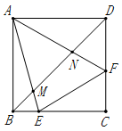

# Mathematics - 题目 3340

**ID**: 275696857ab744aabff0cf6d905cfb6e
**年级**: Grade 9
**难度**: Medium-Hard
**题型**: Fill-in-the-blank

## 题目
如图，正方形 $ABCD$ 中，点 $E,F$ 分别在线段 $BC,CD$ 上运动，且满足 $\angle EAF=45{^{0}}$ ， $AE,AF$ 分别与 $BD$ 相交于点 $M,N$ ，下列说法中：① $BE+DF=EF$ ；​​​​​​​‌②点 $A$ 到线段 $EF$ 的距离一定等于正方形的边长；③若 ${\tan}\angle BAE=\frac {1}{2}$ ，则 ${\tan}\angle DAF=\frac {1}{3}$ ；④若 $BE=2$ ， $DF=3$ ，则 $S{{}_{\Delta AEF}}=15$ ．其中结论正确的是；（将正确的序号填写在横线上）

## 解答

1. 如图，把△ADF绕点A顺时针旋转90°得到△ABH，
2. 
3. 由旋转的性质得，BH=DF，AH=AF，∠BAH=∠DAF，
4. ∵∠EAF=45°，
5. ∴∠EAH=∠BAH+∠BAE=∠DAF+∠BAE=90°-∠EAF=45°，
6. ∴∠EAH=∠EAF=45°，
7. 在△AEF和△AEH中
8. $\begin{cases}AH=AF\\\angle EAH=\angle EAF=45{}^\circ \\AE=AE\end{cases}$
9. ∴△AEF≌△AEH（SAS），
10. ∴EH=EF，
11. ∴∠AEB=∠AEF，
12. ∴BE+BH=BE+DF=EF，
13. 故①正确；
14. 过A作AG⊥EF于G，
15. ∴∠AGE=∠ABE=90°，
16. 在△ABE与△AGE中
17. $\begin{cases}\angle ABE=\angle AGE\\\angle AEB=\angle AEG\\AE=AE\end{cases}$
18. ∴△ABE≌△AGE（AAS），
19. ∴AB=AG，
20. ∴点A到线段EF的距离一定等于正方形的边长；故②正确；
21. ∵tan∠BAE= $\frac {BE}{AB}$ = $\frac {1}{2}$ ，
22. ∴设BE=m，AB=2m，
23. ∴CE=m，
24. 设DF=x，则CF=2m-x，EF=BE+DF=m+x，
25. ∵CF^{2}+CE^{2}=EF^{2}，
26. ∴（2m-x）^{2}+m^{2}=（m+x）^{2}，
27. ∴x= $\frac {2}{3}$ m，
28. ∴tan∠DAF= $\frac {DF}{AD}=\frac {\frac {2}{3}m}{2m}=\frac {1}{3}$ ；故③正确；
29. ∵BE=2，DF=3，
30. ∴EF=BE+DF=5，
31. 设BC=CD=n，
32. ∴CE=n-2，CF=n-3，
33. ∴EF^{2}=CE^{2}+CF^{2}，
34. ∴25=（n-2）^{2}+（n-3）^{2}，
35. ∴n=6（负值舍去），
36. ∴AG=6，
37. ∴S_{△AEF}= $\frac {1}{2}$ ×6×5=15．故④正确，
38. 故答案为①②③④．

## 知识点

**中文**:
  - 全等三角形实际应用
  - 正方形的性质
  - 旋转的性质
  - 正切

**English**:
  - Applications of Congruent Triangles
  - Properties of Squares
  - Properties of Rotation
  - Tangent

---
