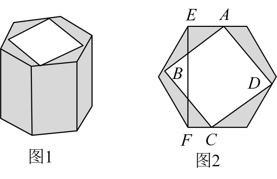

# Mathematics - 题目 2069

**ID**: 299378b25b7b419fa6464381b137669b
**年级**: Grade 9
**难度**: Medium-Hard
**题型**: Fill-in-the-blank

## 题目
图1是一种拼装玩具的零件，它可以看作是底面为正六边形的六棱柱，其内部挖去一个底面为正方形的长方体后得到的几何体，图2是该零件的俯视图，正方形 $ABCD$ 的两个相对的顶点A，C分别在正六边形一组平行的对边上，另外两个顶点B，D在正六边形内部（包括边界），点E，F分别是正六边形的顶点．已知正六边形的边长为2，正方形边长为a．（1）连接 $EF$ ， $EF$ 的长为；​​​​​​​‌（2）a的取值范围是．

## 解答

1. 解：如图，过点 $O$ 作 $OM\bot EF$ ，垂足为点 $M$ ， $ON\bot CD$ ，垂足为点 $N$ ，连接 $OE$ ， $OC$ ，
2. 
3. 则 $EM=FM=\frac {1}{2}EF$ ， $CN=DN=\frac {1}{2}CD$ ，
4. $\because EF$ 是正六边形的一条对角线，
5. $\therefore \angle EOM=\frac {360{}^\circ }{6}\times \frac {1}{2}=60{}^\circ $ ，
6. 在 ${\rm{R}}{\rm{t}}\vartriangle EOM$ 中， $OE=2$ ， $\angle EOM=60{}^\circ $ ，
7. $\therefore EM=\frac {\sqrt {3}}{2}OE=\sqrt {3}$ ，
8. $\therefore EF=2EM=2\sqrt {3}$ ，
9. 故此题答案为： $2\sqrt {3}$ ；
10. 如图①，当正方形 $ABCD$ 的对角线 $AC$ 在正六边形一组平行的对边的中点上时，
11. 正方形边长 $a$ 的值最小， $AC$ 是正方形的对角线，
12. 
13. $\therefore AC=A^{′}D=2\sqrt {3}$ ，
14. $\therefore a=\sqrt {6}$ ，
15. 如图②，当正方形 $ABCD$ 的四个顶点都在正六边形的边上时，正方形边长 $a$ 的值最大， $AC$ 是正方形的对角线 $AC$ ，
16. 
17. 设 $A^{′}(t,\sqrt {3})$ 时，正方形的边长最大，
18. $\because OB^{′}{\bot }OA^{′}$ ，
19. $\therefore B^{′}{\left ({-\sqrt {3}，t}\right )}$ ，
20. 设直线 $MN$ 的解析式为 $y=kx+b$ ， $M(-2,0)$ ， $N(-1,-\sqrt {3})$ ，
21. $\therefore $  $\begin{cases}-2k+b=0\\-k+b=-\sqrt {3}\end{cases}$ ，
22. $\therefore $  $\begin{cases}k=-\sqrt {3}\\b=-2\sqrt {3}\end{cases}$ ，
23. $\therefore $ 直线 $MN$ 的解析式为 $y=-\sqrt {3}x-2\sqrt {3}$ ，
24. 将 $B^{′}{\left ({-\sqrt {3}，t}\right )}$ 代入得 $t=3-2\sqrt {3}$ ，
25. 此时， $A^{′}B^{′}$ 取最大值，
26. $\therefore a=\sqrt {{\left({3-2\sqrt {3}+\sqrt {3}}\right)^{2}}+{\left({\sqrt {3}-3+2\sqrt {3}}\right)^{2}}}=6-2\sqrt {3}$ ，
27. $\therefore $ 正方形边长 $a$ 的取值范围是： $\sqrt {6}\leqslant a\leqslant 6-2\sqrt {3}$ ．
28. 故此题答案为： $\sqrt {6}\leqslant a\leqslant 6-2\sqrt {3}$ ．

## 知识点

**中文**:
  - 正多边形和圆
  - 正方形的性质
  - 解直角三角形

**English**:
  - Regular Polygons and Circles
  - Properties of Squares
  - Solving Right Triangles

---
