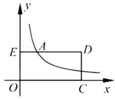

# Mathematics - 题目 2049

**ID**: 2b97fbeed0574a0d8197ddbd36d6a65b
**年级**: Grade 9
**难度**: Medium-Hard
**题型**: Fill-in-the-blank

## 题目
在平面直角坐标系中，对于不在坐标轴上的任意一点 $A\left ({x,y}\right )$ ，我们把点 $B\left ({\frac {1}{x},\frac {1}{y}}\right )$ 称为点A的“倒数点”．如图，矩形 $OCDE$ 的顶点C为 $\left ({3,0}\right )$ ，顶点E在y轴上，函数 $y=\frac {2}{x}\left ({x>0}\right )$ 的图象与 $DE$ 交于点A．若点B是点A的“倒数点”，且点B在矩形 $OCDE$ 的一边上，则 $\vartriangle OBC$ 的面积为．​​​​​​​‌

## 解答

1. 解：根据题意，
2. ∵点 $B\left ({\frac {1}{x},\frac {1}{y}}\right )$ 称为点 $A\left ({x,y}\right )$ 的“倒数点”，
3. ∴ $x\ne 0$ ， $y\ne 0$ ，
4. ∴点B不可能在坐标轴上；
5. ∵点A在函数 $y=\frac {2}{x}\left ({x>0}\right )$ 的图像上，
6. 设点A为 $(x,\frac {2}{x})$ ，则点B为 $(\frac {1}{x},\frac {x}{2})$ ，
7. ∵点C为 $\left ({3,0}\right )$ ，
8. ∴ $OC=3$ ，
9. ①当点B在边DE上时；
10. 点A与点B都在边DE上，
11. ∴点A与点B的纵坐标相同，
12. 即 $\frac {2}{x}=\frac {x}{2}$ ，解得： $x=2$ ，
13. 经检验， $x=2$ 是原分式方程的解；
14. ∴点B为 $(\frac {1}{2},1)$ ，
15. ∴ $\vartriangle OBC$ 的面积为： $S=\frac {1}{2}\times 3\times 1=\frac {3}{2}$ ；
16. ②当点B在边CD上时；
17. 点B与点C的横坐标相同，
18. ∴ $\frac {1}{x}=3$ ，解得： $x=\frac {1}{3}$ ，
19. 经检验， $x=\frac {1}{3}$ 是原分式方程的解；
20. ∴点B为 $(3,\frac {1}{6})$ ，
21. ∴ $\vartriangle OBC$ 的面积为： $S=\frac {1}{2}\times 3\times \frac {1}{6}=\frac {1}{4}$ ；
22. 故答案为： $\frac {1}{4}$ 或 $\frac {3}{2}$ ．

## 知识点

**中文**:
  - 反比例函数综合
  - 解分式方程
  - 坐标与图形性质
  - 矩形的判定与性质综合

**English**:
  - Comprehensive Inverse Proportionality Problems
  - Solving Fractional Equations
  - Coordinates and Geometric Properties
  - Determination and Properties of Rectangles

---
