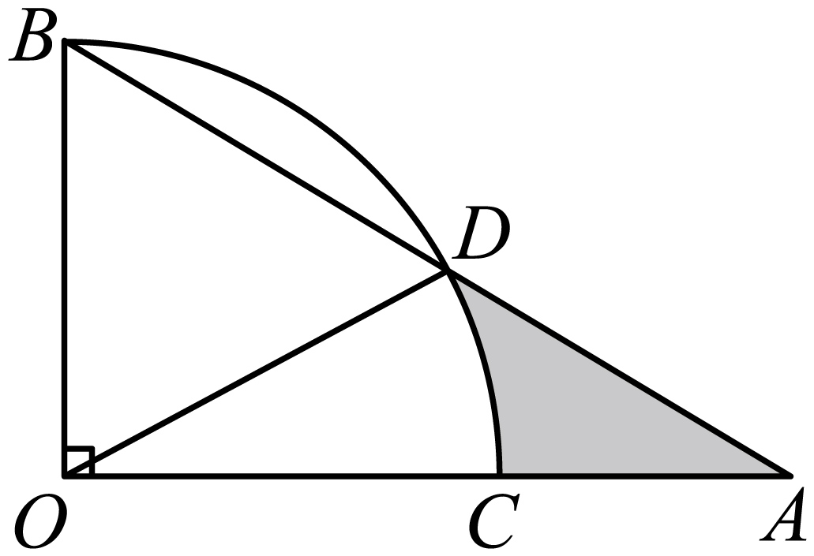

# Mathematics - 题目 1903

**ID**: 2c4848f79c0c46f5b7d464d29e5b54f6
**年级**: Grade 9
**难度**: Medium-Hard
**题型**: Fill-in-the-blank

## 题目
如图，在 ${\rm △\mathit{AOB}}$ 中，∠AOB＝90°，∠A＝30°，OB＝4，以点O为圆心，OB为半径画弧，分别交OA，AB于点C，D，则图中阴影部分的面积是（结果保留π）​​​​​​​‌

## 解答

1. 解： $\because \angle AOB=90{}\degree ，\angle A=30{}\degree ,$OB＝4，
2. $\therefore \angle B=60{}\degree ，$   $AB=2OB，AO=\sqrt {3}OB=4\sqrt {3},$
3. $\because OB=OD$  ，
4. ∴ ${\rm △\mathit{OBD}}$ 是等边三角形
5. $\therefore \angle BOD=60{}\degree ，\angle COD=30{}\degree ，OB=BD，$
6. $\because AB=2OB，OB=BD，$
7. $\therefore BD=AD，$
8. $\therefore S{{}_{阴}}=S{{}_{\mathrm{△}}}{{}_{ADO}}-S{{}_{扇形}}{{}_{OCD}}=\frac {1}{2}S{{}_{\mathrm{△}}}{{}_{ABO}}-S{{}_{扇形}}{{}_{OCD}}=\frac {1}{2}\times \frac {1}{2}\times 4\times 4\sqrt {3}-\frac {30\times \mathrm{π}\times 4{^{2}}}{360}=4\sqrt {3}-\frac {4}{3}\mathrm{π}．$

## 知识点

**中文**:
  - 扇形面积的计算
  - 等边三角形的判定与性质

**English**:
  - Sector Area Calculation
  - Determination and Properties

---
