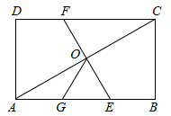

# Mathematics - 题目 1761

**ID**: 2f472d0e309945f89b67429ae88b96f8
**年级**: Grade 9
**难度**: Medium-Hard
**题型**: Fill-in-the-blank

## 题目
如图，在矩形ABCD中，O为AC中点，EF过O点且EF⊥AC分别交DC于F，交AB于E，点G是AE中点且∠AOG=30°．某班学习委员得到四个结论：①DC=3OG；​​​​​​​‌②OG= $\frac {1}{2}$BC；③ $\vartriangle $OGE是等边三角形；④S_{△}_{AOE}= $\frac {1}{6}$S_{矩形}_{ABCD}，问：学习委员得到结论正确的是．（填写所有正确结论的序号）

## 解答

1. 解：∵ $EF\bot AC$ ，点 $G$ 是 $AE$ 中点，
2. ∴ $OG=AG=GE=\frac {1}{2}AE$ ，
3. ∵ $\angle AOG=30^\circ $ ，
4. ∴ $\angle OAG=\angle AOG=30^\circ $ ，
5. $\angle GOE=90^\circ -30^\circ =60^\circ $ ，
6. ∴ $\vartriangle OGE$ 是等边三角形，故③正确；
7. 设 $AE=2a$ ，则 $OE=OG=a$ ，
8. 由勾股定理得， $AO=\sqrt {AE{^{2}}-OE{^{2}}}=\sqrt {(2a){^{2}}-a{^{2}}}=\sqrt {3}a$ ，
9. ∵ $O$ 为 $AC$ 中点，
10. ∴ $AC=2AO=2\sqrt {3}a$ ，
11. ∴ $BC=\frac {1}{2}AC=\frac {1}{2}\times 2\sqrt {3}a=\sqrt {3}a$ ，
12. 在 $Rt\vartriangle ABC$ 中，由勾股定理得， $AB=\sqrt {(2\sqrt {3}a){^{2}}-(\sqrt {3}a){^{2}}}=3a$ ，
13. 四边形 $ABCD$ 是矩形，
14. ∴ $CD=AB=3a$ ，
15. ∴ $DC=3OG$ ，故①正确；
16. ∵ $OG=a$ ， $BC=\sqrt {3}a$ ， $\frac {1}{2}BC=\frac {\sqrt {3}}{2}a$ ，
17. ∴ $OG\ne \frac {1}{2}BC$ ，故②错误；
18. ∵ $S{{}_{\vartriangle AOE}}=\frac {1}{2}a\cdot \sqrt {3}a=\frac {\sqrt {3}}{2}a{^{2}}$ ，
19. $S{{}_{ABCD}}=3a\cdot \sqrt {3}a=3\sqrt {3}a{^{2}}$ ，
20. ∴ $S{{}_{\vartriangle AOE}}=\frac {1}{6}S{{}_{ABCD}}$ ，故④正确；
21. 综上所述，结论正确是①③④，
22. 故答案为：①③④．

## 知识点

**中文**:
  - 直角三角形斜边上的中线
  - 矩形的性质

**English**:
  - Median to Hypotenuse of Right Triangle
  - Properties of Rectangles

---
