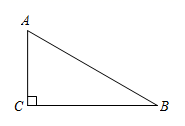

# Mathematics - 题目 3435

**ID**: 2fd8ed480d144ba6ba99cec8ca7ef267
**年级**: Grade 9
**难度**: Medium-Hard
**题型**: Fill-in-the-blank

## 题目
在 ${\rm{R}}{\rm{t}}\mathrm{△}ABC$ 中， $\angle ACB=90{}^\circ $ ， $\angle BAC=60{}^\circ $ ， $BC=\sqrt {3}$ ， $D$ 是 $BC$ 边上一点，沿直线 $AD$ 翻折 $\mathrm{△}ABD$ ，点 $B$ 落在点 $E$ 处，如果 $\angle ABE=45{}^\circ $ ，那么 $BD$ 的长为．​​​​​​​‌

## 解答

1. 解：在Rt△ACB中，∠C=90°，∠BAC=60°，BC= $\sqrt {3}$ ，
2. 
3. ∴AC=1，AB=2．
4. 由折叠的性质可得AF⊥BE，
5. 又∠ABF=45°，∴∠BAF=90°-45°=45°，
6. ∴AF=BF，∴ $\sqrt {2}$ BF=AB，∴BF= $\sqrt {2}$ ．
7. 设CD=x，则BD= $\sqrt {3}$ -x，
8. ∵∠C=∠BFD=90°，∠ADC=∠BDF，
9. ∴△ACD∽△BFD，
10. ∴ $\frac {AC}{BF}=\frac {CD}{DF}$ ，即 $\frac {1}{\sqrt {2}}=\frac {x}{DF}$ ，
11. ∴DF= $\sqrt {2}x$ ．
12. 在Rt△BDF中，BD^{2}=DF^{2}+BF^{2}，
13. ∴（ $\sqrt {3}$ -x）^{2}=（ $\sqrt {2}x$ ）^{2}+（ $\sqrt {2}$ ）^{2}，
14. 整理得，x^{2}+2 $\sqrt {3}$ x-1=0，
15. 解得x=2- $\sqrt {3}$ ，或x=-2- $\sqrt {3}$ （舍去），
16. 即CD=2- $\sqrt {3}$ ，∴BD= $\sqrt {3}$ -x=2 $\sqrt {3}$ -2．
17. 故答案为：2 $\sqrt {3}$ -2．

## 知识点

**中文**:
  - 公式法解一元二次方程
  - 直角三角形的性质
  - 相似三角形的判定与性质综合

**English**:
  - Solving by Quadratic Formula
  - Properties of Right Triangles
  - Determination and Properties

---
