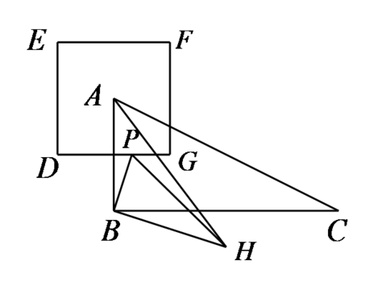

# Mathematics - 题目 1297

**ID**: 31c9c1b4f54d4c3cb15b503cd414daad
**年级**: Grade 9
**难度**: Medium-Hard
**题型**: Fill-in-the-blank

## 题目
如图，点 $A$ 是边长为2的正方形 $DEFG$ 的中心，在 $\vartriangle ABC$ 中， $\angle ABC=90{}^\circ $ ， $AB=2$ ， $BC=4$ ， $DG//BC$ ，点 $P$ 为正方形边上的一动点，在 $BP$ 的右侧作 $\angle PBH=90\mathrm{°}$ 且 $BH=2PB$ ，则 $AH$ 的最大值为．​​​​​​​‌

## 解答

1. 如图，当点P在线段DG上时，连接BD，连接BG并延长到 ${\rm{ }}D^{′}$ ，且使 $GD^{′}=BG$
2. 
3. ∵BC∥DG，∠ABC=90°
4. ∴AB⊥DG
5. ∵四边形DEFG是正方形，且A为正方形的中心，AB=DG=2
6. ∴AB、DG相互垂直平分
7. ∴BD=BG，∠DBG=90°
8. ∴ $BD^{′}=2BD$
9. ∵BH=2PB
10. ∴ $\frac {BD^{′}}{BD}=\frac {BH}{PB}=2$
11. ∵∠DBG=∠PBH=90°
12. ∴ $\angle DBP=\angle D^{′}BH$
13. ∴△ $\mathrm{△}DBP\sim \mathrm{△}D^{′}BH$
14. ∴ $\angle BDG=\angle BD^{′}H$ ， $D^{′}H=2DP$
15. ∵∠BDG=∠BGD=45°，∠DGF=90°
16. ∴∠ $FGD^{′}=45{}^\circ $ ， $\angle BDG=\angle BD^{′}H=45{}^\circ $
17. ∴FG∥$D^{′}H$
18. ∵DG⊥FG
19. ∴DG⊥ $D^{′}H$
20. 故当点P在边DG上运动时，点H则在线段 $D^{′}G^{′}$ 上运动，且 $D^{′}G^{′}=2$DG=4
21. 由此可得，当点P在四边形DEFG上运动时，点H在以C为中心的正方形 $D^{′}E^{′}F^{′}G^{′}$ 上运动，且其边长为4
22. 当点P与点F重合，点H与点 ${\rm{\;}}F^{′}$ 重合时，AH最长，此时连接 $AD^{′}$ ，则 $AD^{′}$ =2
23. 
24. ∴ $AE^{′}=AD^{′}+D^{′}E^{′}=6$
25. 在Rt$\vartriangle AE^{′}F^{′}$ 中，由勾股定理得： $AH=AF^{′}=\sqrt {AE^{′}{{^{2}}}+E^{′}F^{′}{{^{2}}}}=\sqrt {6{^{2}}+4{^{2}}}=2\sqrt {13}$
26. 故答案为： $2\sqrt {13}$

## 知识点

**中文**:
  - 正方形的性质
  - 相似三角形的判定与性质综合

**English**:
  - Properties of Squares
  - Determination and Properties

---
