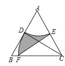

# Mathematics - 题目 1284

**ID**: 324c32bdf78f44218d490dc687341aec
**年级**: Grade 9
**难度**: Medium-Hard
**题型**: Fill-in-the-blank

## 题目
如图，等边三角形 $ABC$ 的边长为2，以 $A$ 为圆心，1为半径作圆分别交 $AB$ ， $AC$ 边于 $D$ ， $E$ ，再以点 $C$ 为圆心， $CD$ 长为半径作圆交 $BC$ 边于 $F$ ，连接 $E$ ， $F$ ，那么图中阴影部分的面积为.​​​​​​​‌

## 解答

1. 过 $A$ 作 $AM\bot BC$ 于 $M$ ， $EN\bot BC$ 于 $N$ ，
2. 
3. $\because $ 等边三角形 $ABC$ 的边长为2， $\angle BAC=\angle B=\angle ACB=60\mathrm{°}$ ，
4. $\therefore AM=\frac {\sqrt {3}}{2}BC=\frac {\sqrt {3}}{2}\times 2=\sqrt {3}$ ，
5. $\because AO=AE=1$ ，
6. $\therefore AD=BD,AE=CE$ ，
7. $\therefore EN=\frac {1}{2}AM=\frac {\sqrt {3}}{2}$ ，
8. $\therefore $ 图中阴影部分的面积 $＝S{{}_{\mathrm{Δ}ABC}}-S{{}_{扇形ADE}}-S{{}_{\mathrm{Δ}CEF}}-(S{{}_{\mathrm{Δ}BCD}}-S{{}_{扇形DCF}})$
9. $=\frac {1}{2}\times 2\times \sqrt {3}-$  $\frac {60\mathrm{•}π\times 1}{360}$  $-\frac {1}{2}\times $  $\sqrt {3}\times \frac {\sqrt {3}}{2}-\left ({\frac {1}{2}\times \frac {1}{2}\times 2\times \sqrt {3}-\frac {30\mathrm{•}π\times 3}{360}}\right )$
10. $=\frac {π}{12}+\frac {\sqrt {3}}{2}-\frac {3}{4}$ ，
11. 故答案为 $\frac {π}{12}+\frac {\sqrt {3}}{2}-\frac {3}{4}$ .

## 知识点

**中文**:
  - 扇形面积的计算
  - 等边三角形的性质

**English**:
  - Sector Area Calculation
  - Properties of Equilateral Triangles

---
