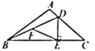

# Mathematics - 题目 2220

**ID**: 326199435e8d43948814895e5be2b219
**年级**: Grade 9
**难度**: Medium-Hard
**题型**: Fill-in-the-blank

## 题目
如图，在 $ΔABC$ 中， $AC=6$ ， $BC=10$ ， ${\tan}C=\frac {3}{4}$ ，点 $D$ 是 $AC$ 边上的动点（不与点 $C$ 重合），过 $D$ 作 $DE\bot BC$ ，垂足为 $E$ ，点 $F$ 是 $BD$ 的中点，连接 $EF$ ，设 $CD=x$ ， $ΔDEF$ 的面积为 $S$ ，则 $S$ 与 $x$ 之间的函数关系式为．​​​​​​​‌

## 解答

1. ∵DE⊥BC，垂足为E，∴tan∠C= $\frac {DE}{CE}$ = $\frac {3}{4}$ ，CD=x，∴DE= $\frac {3}{5}x$ ，CE= $\frac {4}{5}x$ ，则BE=10－ $\frac {4}{5}x$ ，∴S= $\frac {1}{2}$S_{△}_{BED}= $\frac {1}{4}$ （10－ $\frac {4}{5}x$ ）• $\frac {3}{5}x$
2. 化简得： $y=-\frac {3}{25}x{^{2}}+\frac {3}{2}x$ ．
3. 故答案为 $y=-\frac {3}{25}x{^{2}}+\frac {3}{2}x$ ．

## 知识点

**中文**:
  - 三角形的角平分线、中线和高
  - 解直角三角形

**English**:
  - Bisectors, Medians, and Altitudes
  - Solving Right Triangles

---
