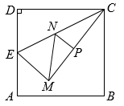

# Mathematics - 题目 288

**ID**: 35afc082d7664299bf83d80f403490fd
**年级**: Grade 9
**难度**: Medium-Hard
**题型**: Fill-in-the-blank

## 题目
如图，在边长为2的正方形ABCD中，点E为AD的中点，将△CDE沿CE翻折得△CME，点M落在四边形ABCE内．点N为线段CE上的动点，过点N作NP//EM交MC于点P，则MN+NP的最小值为．​​​​​​​‌

## 解答

1. 解：作点P关于CE的对称点P′，
2. 
3. 由折叠的性质知CE是∠DCM的平分线，
4. ∴点P′在CD上，
5. 过点M作MF⊥CD于F，交CE于点G，
6. ∵MN+NP=MN+NP′⩽MF，
7. ∴MN+NP的最小值为MF的长，
8. 连接DG，DM，
9. 由折叠的性质知CE为线段DM的垂直平分线，
10. ∵AD=CD=2，DE=1，
11. ∴CE= $\sqrt {1{^{2}}+2{^{2}}}$ = $\sqrt {5}$ ，
12. ∵ $\frac {1}{2}$CE×DO= $\frac {1}{2}$CD×DE，
13. ∴DO= $\frac {2\sqrt {5}}{5}$ ，
14. ∴EO= $\frac {\sqrt {5}}{5}$ ，
15. ∵MF⊥CD，∠EDC=90°，
16. ∴DE∥MF，
17. ∴∠EDO=∠GMO，
18. ∵CE为线段DM的垂直平分线，
19. ∴DO=OM，∠DOE=∠MOG=90°，
20. ∴△DOE≌△MOG，
21. ∴DE=GM，
22. ∴四边形DEMG为平行四边形，
23. ∵∠MOG=90°，
24. ∴四边形DEMG为菱形，
25. ∴EG=2OE= $\frac {2\sqrt {5}}{5}$ ，GM=DE=1，
26. ∴CG= $\frac {3\sqrt {5}}{5}$ ，
27. ∵DE∥MF，即DE∥GF，
28. ∴△CFG∽△CDE，
29. ∴ $\frac {FG}{DE}=\frac {CG}{CE}$ ，即 $\frac {FG}{1}=\frac {\frac {3\sqrt {5}}{5}}{\sqrt {5}}$ ，
30. ∴FG= $\frac {3}{5}$ ，
31. ∴MF=1+ $\frac {3}{5}$ = $\frac {8}{5}$ ，
32. ∴MN+NP的最小值为 $\frac {8}{5}$ ．
33. 故此题答案为： $\frac {8}{5}$ ．

## 知识点

**中文**:
  - 最短路径问题
  - 菱形的判定与性质综合
  - 正方形的性质
  - 轴对称的性质
  - 相似三角形的判定与性质综合

**English**:
  - Shortest Path Problems
  - Determination and Properties of Rhombuses
  - Properties of Squares
  - Properties of Axial Symmetry
  - Determination and Properties

---
