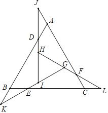

# Mathematics - 题目 1755

**ID**: 3608f180fc3e465fa23deded1d778e0e
**年级**: Grade 9
**难度**: Medium-Hard
**题型**: Fill-in-the-blank

## 题目
如图，在等边三角形 $ABC$ 各边上分别截取 $AD=BE=CF$ ， $DJ\bot BC$ 交 $CA$ 延长线于点 $J$ ， $EK\bot AC$ 交 $AB$ 延长线于点 $K$ ， $FL\bot AB$ 交 $BC$ 延长线于点 $L$ ；​​​​​​​‌直线 $DJ$ ， $EK$ ， $FL$ 两两相交得到 ${\rm{Δ}}GHI$ ，若 $S{{}_{{\rm{Δ}}GHI}}=3\sqrt {3}$ ，则 $AD=$．

## 解答

1. 解：延长 $JD$ 交 $BC$ 于点 $N$ ，
2. 
3. $\because ΔABC$ 是等边三角形，
4. $\therefore AC=BC=AB$ ， $\angle BAC=\angle ACB=\angle ABC=60{}^\circ $ ，
5. $\therefore \angle BDN=\angle JDA=90{}^\circ -60{}^\circ =30{}^\circ $ ，
6. $\therefore \angle J=\angle BAC-\angle JDA=30{}^\circ $ ，
7. 同理可得： $\angle L=\angle K=\angle CFL=\angle JFH=\angle GEL=\angle BEK=30{}^\circ $ ，
8. $\therefore AD=AJ=CF=CL=BE=BK$ ，
9. $\therefore DK=EL=JF$ ，
10. $\therefore {\rm{Δ}}JDA\cong {\rm{Δ}}LFC\cong {\rm{Δ}}KEB\left ({AAS}\right )$ ， ${\rm{Δ}}JHF\cong {\rm{Δ}}LGE\cong {\rm{Δ}}DIK\left ({ASA}\right )$ ，
11. 过点 $A$ 作 $AT\bot BC$ ，交 $BC$ 于点 $T$ ，
12. 设 $AB=BC=AC=a$ ，
13. 
14. 在 ${\rm{R}}{\rm{t}}{\rm{Δ}}ABT$ 中， $\angle BAT=30{}^\circ $ ，
15. $\therefore BT=\frac {1}{2}AB=\frac {1}{2}a$ ， $AT=\sqrt {3}BT=\frac {\sqrt {3}}{2}a$ ，
16. $\therefore S{{}_{{\rm{Δ}}ABC}}=\frac {1}{2}BC\cdot AT=\frac {1}{2}a\cdot \frac {\sqrt {3}}{2}a=\frac {\sqrt {3}}{4}a{^{2}}$ ，
17. $\because AD=AJ=CF=CL=BE=BK$ ， ${\rm{Δ}}JHF\cong {\rm{Δ}}LGE\cong {\rm{Δ}}DIK$ ，
18. $\therefore JF=EL=DK=a$ ，
19. 过点 $H$ 作 $HM\bot AC$ ，交 $AC$ 于点 $M$ ，
20. 
21. $\because \angle J=\angle JFH=30{}^\circ $ ，
22. $\therefore JH=FH$ ，
23. $\therefore JM=\frac {1}{2}JF=\frac {1}{2}a$ ，
24. 在 ${\rm{R}}{\rm{t}}{\rm{Δ}}JHM$ 中， $HM=\frac {\sqrt {3}}{3}JM=\frac {\sqrt {3}}{6}a$ ，
25. $\therefore S{{}_{{\rm{Δ}}JHF}}=\frac {1}{2}JF\cdot HM=\frac {1}{2}a\cdot \frac {\sqrt {3}}{6}a=\frac {\sqrt {3}}{12}a{^{2}}$ ，
26. $\therefore S{{}_{{\rm{Δ}}JHF}}+S{{}_{{\rm{Δ}}LJE}}+S{{}_{{\rm{Δ}}DIK}}=3S{{}_{{\rm{Δ}}JHF}}=3\times \frac {\sqrt {3}}{12}a{^{2}}=\frac {\sqrt {3}}{4}a{^{2}}=S{{}_{{\rm{Δ}}ABC}}$ ，
27. $\therefore S{{}_{{\rm{Δ}}JDA}}+S{{}_{{\rm{Δ}}FCL}}+S{{}_{{\rm{Δ}}BEK}}=3S{{}_{{\rm{Δ}}JDA}}=S{{}_{{\rm{Δ}}GHI}}$ ，
28. 过点 $A$ 作 $AP\bot DJ$ ，交 $DJ$ 于点 $P$ ，
29. 
30. 设 $AD=x$ ，
31. 在 ${\rm{R}}{\rm{t}}{\rm{Δ}}APD$ 中， $\angle ADP=30{}^\circ $ ，
32. $\therefore AP=\frac {1}{2}AD=\frac {1}{2}x$ ， $DP=\sqrt {3}AP=\frac {\sqrt {3}}{2}x$ ，
33. $\therefore JD=2DP=\sqrt {3}x$ ，
34. $\therefore 3S{{}_{{\rm{Δ}}JDA}}=3\times \frac {1}{2}JD\cdot AP=\frac {3}{2}\times \sqrt {3}x\cdot \frac {1}{2}x=\frac {3\sqrt {3}}{4}x{^{2}}$ ，
35. $\therefore $  $\frac {3\sqrt {3}}{4}x{^{2}}=3\sqrt {3}$ ，
36. 解得： $x=\pm 2$ （负值舍去），
37. 即 $AD$ 的值为2，
38. 故答案为：2．

## 知识点

**中文**:
  - 全等三角形的综合问题
  - 等边三角形的判定与性质
  - 含30度角的直角三角形

**English**:
  - Comprehensive Problems
  - Determination and Properties
  - Right Triangle with 30° Angle

---
