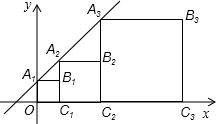

# Mathematics - 题目 1854

**ID**: 3e3ce19588464c4ba999c36e15ef471d
**年级**: Grade 9
**难度**: Medium-Hard
**题型**: Fill-in-the-blank

## 题目
正方形 $A{{}_{1}}B{{}_{1}}C{{}_{1}}O$ ， $A{{}_{2}}B{{}_{2}}C{{}_{2}}C{{}_{1}}$ ， $A{{}_{3}}B{{}_{3}}C{{}_{3}}C{{}_{2}}$ ，…按如图所示的方式放置，点 $A{{}_{1}}$ ， $A{{}_{2}}$ ， $A{{}_{3}}$ ，…和点 $C{{}_{1}}$ ， $C{{}_{2}}$ ， $C{{}_{3}}$ ，…分别在直线 $y=kx+b\left ({k>0}\right )$ 和 $x$ 轴上，已知点 $B{{}_{1}}\left ({1,1}\right )$ ， $B{{}_{2}}\left ({3,2}\right )$ ，则 $B{{}_{2020}}$ 的坐标是．​​​​​​​‌

## 解答

1. $\because B{{}_{1}}\left ({1,1}\right )$ ， $B{{}_{2}}\left ({3,2}\right )$
2. $\therefore OA{{}_{1}}=OC{{}_{1}}=1,A{{}_{2}}C{{}_{1}}=B{{}_{2}}C{{}_{2}}=2,OC{{}_{2}}=3$
3. $\therefore $  $A{{}_{1}}(0,1),A{{}_{2}}(1,2)$ ，点 $A{{}_{3}}$ 的横坐标为3
4. 将 $A{{}_{1}}(0,1),A{{}_{2}}(1,2)$ 代入 $y=kx+b$ 得 $\begin{cases}b=1\\k+b=2\end{cases}$ ，解得 $\begin{cases}k=1\\b=1\end{cases}$
5. 则直线 $y=kx+b$ 的解析式为 $y=x+1$
6. 令 $x=3$ 得 $y=3+1=4$
7. $\therefore A{{}_{3}}(3,4)$
8. $\therefore $ 点 $B{{}_{3}}$ 的横坐标为 $3+4=7$ ，纵坐标为4，即 $B{{}_{3}}(7,4)$
9. 观察可知， $B{{}_{1}}\left ({1,1}\right )$ 可化为 $B{{}_{1}}\left ({2{^{1}}-1,2{^{0}}}\right )$
10. $B{{}_{2}}\left ({3,2}\right )$ 可化为 $B{{}_{2}}\left ({2{^{2}}-1,2{^{1}}}\right )$
11. $B{{}_{3}}(7,4)$ 可化为 $B{{}_{3}}(2{^{3}}-1,2{^{2}})$
12. 归纳类推得：点 $B{{}_{n}}$ 的坐标为 $B{{}_{n}}(2{^{n}}-1,2{^{n-1}})$ ，其中n为正整数
13. 则点 $B{{}_{2020}}$ 的坐标为 $(2{^{2020}}-1,2{^{2019}})$
14. 故答案为： $(2{^{2020}}-1,2{^{2019}})$ ．

## 知识点

**中文**:
  - 归纳与类比
  - 规律型：图形的变化类
  - 正方形的性质
  - 待定系数法求一次函数解析式

**English**:
  - Induction and Analogy
  - Patterns: Geometric Variations
  - Properties of Squares
  - Finding Expressions by Undetermined Coefficients

---
