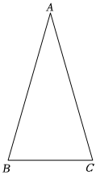

# Mathematics - 题目 1367

**ID**: 3ead9a3bec874be4aee418951764195c
**年级**: Grade 9
**难度**: Medium-Hard
**题型**: Fill-in-the-blank

## 题目
$\vartriangle ABC$ 中， $AB=AC$ ， $\angle A=α$ ，点 $D$ 在 $AB$ 边上 $($ 不与A， $B$ 重合 $)$ ，过点 $D$ 作 $DE{\rm{/\mskip-4mu/}}BC$ 交 $AC$ 于 $E$ ，将 $\vartriangle ADE$ 绕点 $A$ 旋转得到 $\vartriangle AD^{′}E^{′}．$ 下列结论:    $①\vartriangle AD^{′}E^{′}$ ∽ $\vartriangle ABC$  ；​​​​​​​‌ $②$ 只有当 $β>α$ 时， $BD^{′}=CE^{′}$ 成立； $③$ 当 $D$ 与 $E^{′}$ 重合时 $D^{′}E\bot AB$  ； $④$ 旋转过程中 $\angle EE^{′}D$ 的度数与旋转角 $β$ 有一定数量关系； $⑤$ 旋转过程中 $\angle EE^{′}D$ 的度数与 $α$ 有一定数量关系； $⑥$ 当 $α=37{}^\circ $ 时，存在 $β$ 使得 $B$ ， $D$ ， $E$ 共线．一定正确的是．

## 解答

1. 根据题意作图如下：
2. 
3. $①\because $  $DE{\rm{/\mskip-4mu/}}BC$ ．
4. $\therefore \angle ADE=\angle ABC．\angle ACB=\angle ABD$
5. $\therefore \vartriangle ADE∽$  $\vartriangle ABC$ ．
6. $\because AB=AC$ ．
7. $\therefore \frac {AD}{AE}=\frac {AB}{AC}=1$ ， $AD=AE$ ．
8. 由旋转知： $\mathrm{△}ADE≌$  $\mathrm{△}AD^{′}E^{′}$
9. $\therefore \vartriangle AD^{′}E^{′}∽$  $\vartriangle ABC．$ 故 $①$ 符合题意．
10. $②\because \angle DAE=\angle D^{′}AE^{′}=\angle BAC$ ．
11. $\therefore \angle BAD^{′}=\angle CAE^{′}$
12. 又 $AB=AC$ ， $AD^{′}=AE^{′}=AD=AE$ ．
13. $\therefore \vartriangle BAD^{′}≌$  $\vartriangle CAE^{′}{\left ({{\rm{S}}{\rm{A}}{\rm{S}}}\right )}$ ，
14. $\therefore BD^{′}=CE^{′}$ 与 $β$ 无关．故 $②$ 不符合题意．
15. $③$ 当 $D$ 与 $E^{′}$ 重合时，
16. 
17. $\therefore AD{^{\prime }}=AE$ ， $DD^{′}=DE$ ， $AD=AD$ ．
18. $\therefore \begin{cases}AD^{′}=AE\\DD^{′}=DE\\AD=AD\end{cases}$ ．
19. $\therefore \vartriangle ADD^{′}≌$  $\vartriangle AED\left ({{\rm{S}}{\rm{S}}{\rm{S}}}\right )$ ．
20. $\therefore \angle DAD^{′}=\angle EAD$ ，
21. $\because AD^{′}=AE$ ．
22. $\therefore D^{′}E\bot AB．$ 故 $③$ 符合题意．
23. $④$ 由旋转知： $AE^{′}=AD=AE$ ．
24. $\therefore \angle AE^{′}D=\left ({180{}^\circ -\angle DAE^{′}}\right )\div 2$
25. $\angle AEE^{′}=\left ({180{}^\circ -\angle EAE^{′}}\right )\div 2$ ．
26. $\therefore \angle EE^{′}D=\left ({\angle DAE^{′}-\angle EAE^{′}}\right )\div 2=\angle DAE\div 2=\frac {α}{2}$ ．
27. $\therefore $ 与 $β$ 没有一定数量关系．故 $④$ 不符合题意．
28. $⑤$ 由 $④$ 知 $\angle EE^{′}D=\frac {α}{2}．$ 与 $β$ 没有一定数量关系．故 $⑤$ 符合题意．
29. $⑥$ 延长 $BZ$ ，以A为圆心， $AZ$ 长为半径画弧，交直线 $BZ$ 于 $D^{′}$ ．
30. 
31. 当 $\angle BZA\ne 90{}^\circ $ 时，弧始终与直线 $BZ$ 有 $2$ 个交点，
32. 即 $α\ne 90{}^\circ $ 时，存在 $β$ 使 $BD^{′}Z$ 共线，
33. 故 $⑥$ 符合题意．
34. 故此题答案为： $①③⑤⑥$ ．

## 知识点

**中文**:
  - 旋转的性质
  - 等腰三角形的判定与性质
  - 相似三角形的判定与性质综合

**English**:
  - Properties of Rotation
  - Determination and Properties
  - Determination and Properties

---
