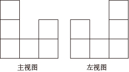

# Mathematics - 题目 1194

**ID**: 42d8672fc9f3423fbf21822013a483fe
**年级**: Grade 9
**难度**: Medium-Hard
**题型**: Fill-in-the-blank

## 题目
一个由13个完全相同的小立方块搭成的几何体，其最下面一层摆放了9个小立方块，它的主视图和左视图如图所示，则这个几何体的搭法共有种．​​​​​​​‌

## 解答

1. 解：由题意俯视图：除了A，B，C不能确定，其余位置上的小立方体是确定的数字如图所示．
2. 
3. ∵由13个完全相同的小立方块搭成的几何体，其最下面一层摆放了9个小立方块，
4. ∴A为1，B为2，C为2或A为2，B为2，C为1或A为2，B为1，C为2，
5. 共三种情形，
6. 故答案为：3．

## 知识点

**中文**:
  - 由三视图还原几何体

**English**:
  - Reconstructing Solid from Three Views

---
