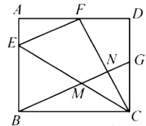

# Mathematics - 题目 39

**ID**: 42db1461b7ad47f4beec260ec98501b1
**年级**: Grade 9
**难度**: Medium-Hard
**题型**: Fill-in-the-blank

## 题目
如图，在矩形 $ABCD$ 中，点E在边 $AB$ 上， $\mathrm{△}BEC$ 与 $\vartriangle FEC$ 关于直线 $EC$ 对称，点B的对称点F在边 $AD$ 上，G为 $CD$ 中点，连结 $BG$ 分别与 $CE,CF$ 交于M，N两点，若 $BM=BE$ ， $MG=1$ ，则 $BN$ 的长为， ${\sin}\angle AFE$ 的值为．​​​​​​​‌

## 解答

1. 解： $\because $   $\mathrm{△}BEC$ 与 $\vartriangle FEC$ 关于直线 $EC$ 对称，矩形 $ABCD,$
2. $\therefore \vartriangle BEC≌\vartriangle FEC,$   $\angle ABC=\angle ADC=\angle BCD=90{}^\circ ,$
3. $\therefore \angle EBC=\angle EFC=90{}^\circ ,\angle BEC=\angle FEC,BE=FE,BC=FC,$
4. $\because BM=BE,$
5. $\therefore \angle BEM=\angle BME,$
6. $\therefore \angle FEC=\angle BME,$
7. $\therefore EF{\rm{/}}{\rm{/}}MN,$
8. $\therefore \angle BNC=\angle EFC=90{}^\circ ，$
9. $\therefore \angle BNC=\angle FDC=90{}^\circ ,$
10. $\because \angle BCD=90{}^\circ ,$
11. $\therefore \angle NBC+\angle BCN=90{}^\circ =\angle BCN+\angle DCF,$
12. $\therefore \angle NBC=\angle DCF,$
13. $\therefore \vartriangle BCN≌\vartriangle CFD,$
14. $\therefore BN=CD,$
15. $\because $  矩形 $ABCD,$
16. $\therefore AB{\rm{/}}{\rm{/}}CD,AD{\rm{/}}{\rm{/}}BC,$
17. $\therefore \angle BEM=\angle GCM,$
18. $\because \angle BEM=\angle BME=\angle CMG,MG=1,G$ 为 $CD$ 的中点，
19. $\therefore \angle GMC=\angle GCM,$
20. $\therefore CG=MG=1,CD=2,$
21. $\therefore BN=2.$
22. 如图， $\because BM=BE=FE,MN{\rm{/}}{\rm{/}}EF,$  四边形 $ABCD$ 都是矩形，
23. $\therefore AB=CD,AD{\rm{/}}{\rm{/}}BC,\angle A=\angle BCG=90{}^\circ ,$   $\angle AEF=\angle ABG,$
24. $\because \angle AFE+\angle AEF=90{}^\circ =\angle ABG+\angle CBG,$
25. $\therefore \angle AFE=\angle CBG,$
26. 
27. $\therefore \vartriangle AFE∽\vartriangle CBG,$
28. $\therefore \frac {AE}{CG}=\frac {EF}{BG},$
29. 设 $BM=x,$  则 $BE=BM=FE=x,BG=x+1,AE=2-x,$
30. $\therefore \frac {2-x}{1}=\frac {x}{x+1},$
31. 解得： $x=\pm \sqrt {2},$
32. 经检验： $x=\pm \sqrt {2}$ 是原方程的根，但 $x=-\sqrt {2}$ 不合题意，舍去，
33. $\therefore AE=2-\sqrt {2},EF=\sqrt {2},$
34. $\therefore {\sin}\angle AFE=\frac {AE}{EF}=\frac {2-\sqrt {2}}{\sqrt {2}}=\sqrt {2}-1.$
35. 故答案为： $2,\sqrt {2}-1.$

## 知识点

**中文**:
  - 正弦
  - 矩形的判定与性质综合

**English**:
  - Sine
  - Determination and Properties of Rectangles

---
