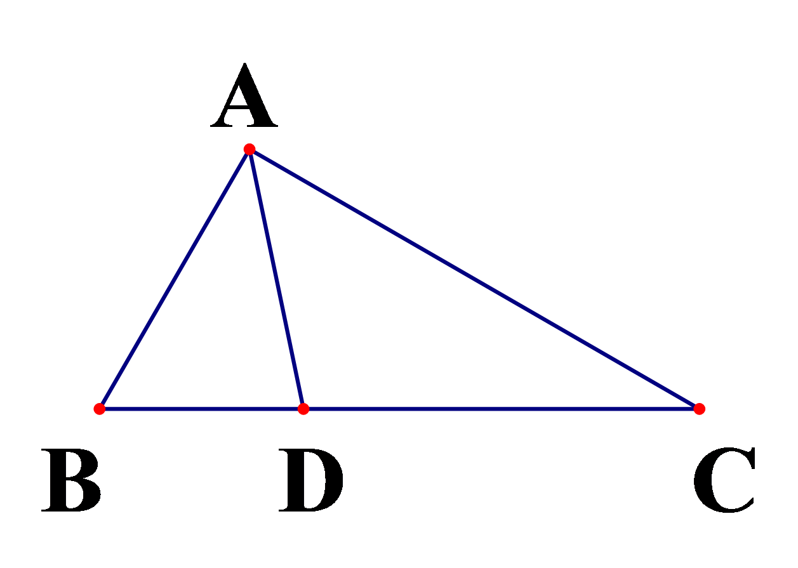

# Mathematics - 题目 3120

**ID**: 434c0b2d24364a6ebf827da98ede5be7
**年级**: Grade 9
**难度**: Medium-Hard
**题型**: Fill-in-the-blank

## 题目
如图，在△ABC中，∠A=90°，∠B=60°，AB=2，若D是BC边上的动点，则2AD+DC的最小值为．​​​​​​​‌

## 解答

1. 解：如图， $\because \angle BAC=90{}^\circ ,\angle B=60{}^\circ ,AB=2,$
2. $\therefore \angle C=30{}^\circ ,BC=4,AC=2\sqrt {3},$
3. 取AC的中点F，过F作 $FG\bot BC$ 于G，延长FG至E，使EG=FG，连接AE交BC于D，则 $FD+AD=AD+DE=AE,$  此时 $AD+FD$ 最短，
4. $\because \angle C=30{}^\circ ,CF=\frac {1}{2}AC=\sqrt {3},$
5. $\therefore FG=EG=\frac {\sqrt {3}}{2},CG=\frac {3}{2},$
6. 过A作 $AH\bot BC$ 于H，则由 $\frac {1}{2}AB\cdot AC=\frac {1}{2}BC\cdot AH,$
7. $\therefore AH=\sqrt {3},$
8. $\therefore BH=1,HG=4-1-\frac {3}{2}=\frac {3}{2},$
9. $\because AH\bot BC,FG\bot BC,$
10. $\therefore AH//FG,$
11. $\therefore ΔEDG∽ΔADH,$
12. $\therefore \frac {EG}{AH}=\frac {DG}{DH}=\frac {1}{2},$
13. $\therefore DG=\frac {1}{2},DH=1,$
14. $\therefore BD=2,$
15. $\mathrm{∴}D$ 为BC的中点，
16. $\therefore AD=\frac {1}{2}BC=2,FD=\frac {1}{2}AB=1=DE,$
17. $\therefore AD+FD=3,$
18. $\therefore 2DF=DC,$
19. $\therefore 2AD+CD=2AD+2DF=2(AD+DF)=6,$
20. 即 $2AD+CD$ 的最小值为6．
21. 故答案为：6．
22. 

## 知识点

**中文**:
  - 直角三角形斜边上的中线
  - 相似三角形的判定与性质综合
  - 解直角三角形

**English**:
  - Median to Hypotenuse of Right Triangle
  - Determination and Properties
  - Solving Right Triangles

---
