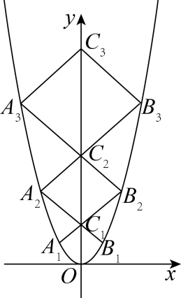

# Mathematics - 题目 2826

**ID**: 43d0262ca4244a8fb673fdfe53da6884
**年级**: Grade 9
**难度**: Medium-Hard
**题型**: Fill-in-the-blank

## 题目
如图，已知点 $A{{}_{1}}$ ， $A{{}_{2}}$ ， $\ldots $ ， $A{{}_{2020}}$ 在函数 $y=x{^{2}}$ 位于第二象限的图象上，点 $B{{}_{1}}$ ， $B{{}_{2}}$ ， $\ldots $ ， $B{{}_{2020}}$ 在函数 $y=x{^{2}}$ 位于第一象限的图象上，点 $C{{}_{1}}$ ， $C{{}_{2}}$ ， $\ldots $ ， $C{{}_{2020}}$ 在 $y$ 轴的正半轴上，若四边形 $OA{{}_{1}}C{{}_{1}}B{{}_{1}}$ 、 $C{{}_{1}}A{{}_{2}}C{{}_{2}}B{{}_{2}}$ ， $\ldots $ ， $C{{}_{2021}}A{{}_{2022}}C{{}_{2022}}B{{}_{2022}}$ 都是正方形，则正方形 $C{{}_{2021}}A{{}_{2022}}C{{}_{2022}}B{{}_{2022}}$ 的对角线长为．​​​​​​​‌

## 解答

1. 解： $\because OA{{}_{1}}C{{}_{1}}B{{}_{1}}$ 是正方形，
2. $\therefore OB{{}_{1}}$ 与 $y$ 轴的夹角为 $45{}\degree $ ，
3. $\therefore OB{{}_{1}}$ 的解析式为 $y=x$ ，
4. 联立方程组得： $\begin{cases}y=x\\y=x{^{2}}\end{cases}$ ，
5. 解得 $\begin{cases}x=0\\y=0\end{cases}$ 或 $\begin{cases}x=1\\y=1\end{cases}$ ，
6. $\therefore B{{}_{1}}$ 点的坐标是： $(1,1)$ ；
7. $\therefore OB{{}_{1}}=\sqrt {1{^{2}}+1{^{2}}}=\sqrt {2}$ ，
8. $\therefore OC{{}_{1}}=2$ ，
9. $\therefore C{{}_{1}}\left ({0,2}\right )$ ，
10. $\because OB{{}_{1}}\parallel C{{}_{1}}B{{}_{2}}$
11. ∴直线 $C{{}_{1}}B{{}_{2}}$ 的解析式为： $y=x+2$ ，
12. 联立方程组得： $\begin{cases}y=x+2\\y=x{^{2}}\end{cases}$ ，
13. 解得 $\begin{cases}x=-1\\y=1\end{cases}$ 或 $\begin{cases}x=2\\y=4\end{cases}$ ，
14. $\therefore B{{}_{2}}$ 点的坐标是： $(2,4)$ ；
15. $\therefore C{{}_{1}}B{{}_{2}}=\sqrt {{\left({0-2}\right)^{2}}+{\left({2-4}\right)^{2}}}=2\sqrt {2}$ ，
16. $\therefore C{{}_{1}}C{{}_{2}}=\sqrt {2}C{{}_{1}}B{{}_{2}}=4$ ，
17. $\ldots $
18. 依此类推，则正方形 $C{{}_{2021}}A{{}_{2022}}C{{}_{2022}}B{{}_{2022}}$ 的边长为 $2022\sqrt {2}$ ，
19. ∴其对角线长为 $2022\sqrt {2}\times \sqrt {2}=4044$

## 知识点

**中文**:
  - y=ax²的图象与性质
  - 规律型：图形的变化类
  - 正方形的性质

**English**:
  - Graph and Properties of y=ax²
  - Patterns: Geometric Variations
  - Properties of Squares

---
