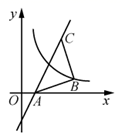

# Mathematics - 题目 1656

**ID**: 47e50a67c2c546639af6747cf626f8e9
**年级**: Grade 9
**难度**: Medium-Hard
**题型**: Fill-in-the-blank

## 题目
如图，过点C(3,4)的直线 $y=2x+b$ 交 $x$ 轴于点A，∠ABC=90°，AB=CB，曲线 $y=\frac {k}{x}（x>0）$ 过点B，将点A沿 $y$ 轴正方向平移 $a$ 个单位长度恰好落在该曲线上，则 $a$ 的值为．​​​​​​​‌

## 解答

1. 分别过点B、点C作 $y$ 轴和 $x$ 轴的平行线，两条平行线相交于点M，与 $x$ 轴的交点为N，则∠M=∠ANB=90°，
2. 把C(3,4)代入 $y=2x+b$ ，得4=6+b，解得：b=-2，
3. 所以y=2x-2，
4. 令y=0，则0=2x-2，解得：x=1，
5. 所以A(1，0)，
6. ∵∠ABC=90°，
7. ∴∠CBM+∠ABN=90°，
8. ∵∠ANB=90°，
9. ∴∠BAN+∠ABN=90°，
10. ∴∠CBM=∠BAN，
11. 又∵∠M=∠ANB=90°，AB=BC，
12. ∴△ABN≌△BCM，
13. ∴AN=BM，BN=CM，
14. ∵C(3，4)，∴设AN=m，CM=n，
15. 则有 $\begin{cases}m+n=4\\m+1-n=3\end{cases}$ ，解得 $\begin{cases}m=3\\n=1\end{cases}$ ，
16. ∴ON=3+1=4，BN=1，
17. ∴B(4，1)，
18. ∵曲线 $y=\frac {k}{x}（x>0）$ 过点B，
19. ∴k=4，
20. ∴ $y=\frac {4}{x}$ ，
21. ∵将点A沿 $y$ 轴正方向平移 $a$ 个单位长度恰好落在该曲线上，此时点A移动后对应点的坐标为(1，a)，
22. ∴a=4，
23. 故答案为：4.
24. 

## 知识点

**中文**:
  - 几何变换——平移综合题
  - 反比例函数综合

**English**:
  - Translation Comprehensive Problems
  - Comprehensive Inverse Proportionality Problems

---
