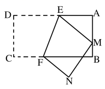

# Mathematics - 题目 2177

**ID**: 4973c7ba5ea64cdb81d62db53a82b90a
**年级**: Grade 9
**难度**: Medium-Hard
**题型**: Fill-in-the-blank

## 题目
如图，折叠矩形纸片 $ABCD$ ，使点 $D$ 落在 $AB$ 边的点 $M$ 处，点 $C$ 落在点 $\mathbf{N}$ 处， $EF$ 为折痕， $AB=1$ ， $AD=2$ ，设 $AM=t$ ，四边形 $CDEF$ 的面积为 $S$ ，则 $S$ 关于 $t$ 的函数表达式为．​​​​​​​‌

## 解答

1. ∵ $AB=1$ ， $AM=t$
2. ∴ $BM=1-t$
3. 设 $AE=x$ ， $CF=y$
4. 根据题意，得 $DE=EM$ ， $CF=FN=y$
5. ∵ $AD=2$
6. ∴ $DE=EM=2-x$
7. ∵矩形纸片 $ABCD$
8. ∴ $\angle A=\angle B=\angle EMN=90{}^\circ $
9. ∴ $AE{^{2}}+AM{^{2}}=EM{^{2}}$ ，即 $x{^{2}}+t{^{2}}={\left({2-x}\right)^{2}}$
10. ∴ $x=\frac {4-t{^{2}}}{4}$
11. ∴ $EM=2-x=\frac {t{^{2}}+4}{4}$
12. ∵ $\angle AME+\angle BMG=90{}^\circ $ ， $\angle AME+\angle AEM=90{}^\circ $
13. ∴ $\angle BMG=\angle AEM$
14. ∴ $△AEM∽△BMG$
15. ∴ $\frac {GM}{EM}=\frac {BM}{AE}$ ，即 $\frac {GM}{\frac {t{^{2}}+4}{4}}=\frac {1-t}{\frac {4-t{^{2}}}{4}}$
16. ∴ $GM=\frac {\left ({t{^{2}}-4}\right )\left ({1-t}\right )}{4-t{^{2}}}$
17. ∵ $\angle NGF=\angle BGM$
18. ∴ $\angle NGF{\rm{+}}\angle BMG=90{}^\circ $
19. ∴ $\angle NGF=\angle AME$
20. ∴ $△AEM∽△NFG$
21. ∴ $\frac {NG}{AM}=\frac {FN}{AE}$ ，即 $\frac {NG}{t}=\frac {y}{\frac {4-t{^{2}}}{4}}$
22. ∴ $NG=\frac {4yt}{4-t{^{2}}}$
23. ∵ $GM+NG=MN=CD=1$
24. ∴ $\frac {\left ({t{^{2}}-4}\right )\left ({1-t}\right )}{4-t{^{2}}}{\rm{+}}\frac {4yt}{4-t{^{2}}}=1$
25. ∴ $y=\frac {t{^{2}}-2t+4}{4}$
26. ∴ $S=\frac {1}{2}\left ({CF+DE}\right )\times CD=\frac {1}{2}\left ({\frac {t{^{2}}-2t+4}{4}+\frac {t{^{2}}+4}{4}}\right )=\frac {1}{4}t{^{2}}-\frac {1}{4}t+1$
27. 故答案为： $S=\frac {1}{4}t{^{2}}-\frac {1}{4}t+1$ ．

## 知识点

**中文**:
  - 几何变换——轴对称综合题
  - 矩形的性质
  - 相似三角形的判定与性质综合
  - 折叠问题

**English**:
  - Axial Symmetry Comprehensive Problems
  - Properties of Rectangles
  - Determination and Properties
  - Folding Problems

---
