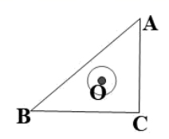

# Mathematics - 题目 1370

**ID**: 4db6e001e9114c589507bde42d1e72a6
**年级**: Grade 9
**难度**: Medium-Hard
**题型**: Fill-in-the-blank

## 题目
如图，在 $\vartriangle ABC$ 中， $AC:BC:AB=3:4:5$ ，当半径为1的 $\odot O$ 在 $\vartriangle ABC$ 内自由移动时，圆心 $O$ 在 $\vartriangle ABC$ 内所能到达的区域面积为6，则 $\vartriangle ABC$ 的外接圆面积为．​​​​​​​‌

## 解答

1. 解：如图， $\because AC:BC:AB=3:4:5$ ，
2. 设 $AC=3m$ ， $BC=4m$ ， $AB=5m$ ，
3. $\therefore AC{^{2}}+BC{^{2}}=9m{^{2}}+16m{^{2}}=25m{^{2}}=AB{^{2}}$ ，
4. $∴ΔABC$ 是直角三角形，且 $\angle ACB=90{}^\circ $ ，
5. 由题意， $\odot D$ ， $\odot E$ ， $\odot F$ 和 $ΔABC$ 的两边相切，此时，点 $O$ 所能到达的区域是 $ΔDEF$ ，连接 $DE$ 、 $EF$ 、 $DF$ ，
6. $\because $ 圆心 $O$ 在 $ΔABC$ 内所能到达的区域的面积为6，
7. $\therefore S{{}_{ΔDEF}}=6$ ，
8. $\because DE//AC$ ， $DF//AB$ ， $EF//BC$ ，
9. $\therefore \angle DEF=\angle ACB=90{}^\circ $ ， $\angle DFE=\angle ABC$ ，
10. $\therefore ΔDEF∽ΔACB$ ，
11. $\therefore DE:EF:DF=AC:BC:AB=3:4:5$ ，
12. 设 $DE=3k(k>0)$ ，则 $EF=4k$ ， $DF=5k$ ，
13. $\therefore S{{}_{ΔDEF}}=\frac {1}{2}DE\cdot EF=\frac {1}{2}\times 3k\cdot 4k=6$ ，
14. $\therefore k=1$ 或 $-1$ （舍 $)$ ，
15. $\therefore DE=3$ ， $EF=4$ ， $DF=5$ ，
16. 设切点分别为 $G$ 、 $H$ 、 $P$ 、 $Q$ 、 $M$ 、 $N$ ，
17. 连接 $DH$ 、 $DG$ 、 $EP$ 、 $EQ$ 、 $FM$ 、 $FN$ ，
18. 得矩形 $DEPG$ 、矩形 $EQNF$ 、矩形 $DEMH$ ，
19. $\therefore DE=GP=3$ ， $EF=QN=4$ ， $DF=HM=5$ ，
20. 根据切线长定理四边形 $CPEQ$ 是正方形，
21. $\therefore PC=PE=EQ=CQ=1$ ，
22. 根据切线长定理，
23. 设 $AG=AH=x$ ， $BN=BM=y$ ，
24. 则 $AC=AG+GP+CP=x+3+1=x+4$ ，
25. $BC=CQ+QN+BN=1+4+y=y+5$ ，
26. $AB=AH+HM+BM=x+5+y=x+y+5$ ，
27. $\because AC:BC:AB=3:4:5$ ，
28. $\therefore (x+4):(y+5):(x+y+5)=3:4:5$ ，
29. 解得 $x=2$ ， $y=3$ ，
30. $\therefore AC=6$ ， $BC=8$ ， $AB=10$ ，
31. $\because \angle ACB=90{}^\circ $ ，
32. $∴ΔABC$ 的外接圆的半径 $=5$ ，
33. $∴ΔABC$ 的外接圆面积为 $25π$ ，
34. 故答案为： $25π$ ．
35. 

## 知识点

**中文**:
  - 三角形内切圆与外接圆综合

**English**:
  - Incircle and Circumcircle

---
