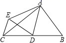

# Mathematics - 题目 3993

**ID**: 4f459dcc970544abbaf4cdda760809b6
**年级**: Grade 9
**难度**: Medium-Hard
**题型**: Fill-in-the-blank

## 题目
如图,△ ABC 中,∠BAC=90°，AB=3，AC=4，点 D 是 BC 的中点，将△ ABD 沿 AD 翻折得到△ AED，连 CE,则线段 CE 的长等于​​​​​​​‌

## 解答

1. 如图，过点A作AH⊥BC于点H，连接BE交AD于点O，
2. ∵△ABC中，∠BAC=90°，AB=3，AC=4，点D是BC的中点，
3. ∴BC= $\sqrt {3{^{2}}+4{^{2}}}=5$ ，AD=BD=2.5，
4. ∴ $\frac {1}{2}$ BC·AH= $\frac {1}{2}$ AC·AB，即2.5AH=6，
5. ∴AH=2.4，
6. 由折叠的性质可知，AE=AB，DE=DB=DC，
7. ∴AD是BE的垂直平分线，△BCE是直角三角形，
8. ∴S_{△ADB}= $\frac {1}{2}$ AD·OB= $\frac {1}{2}$ BD·AH，
9. ∴OB=AH=2.4，
10. ∴BE=4.8，
11. ∴CE= $\sqrt {5{^{2}}-4.8{^{2}}}=\frac {7}{5}$ .
12. 故答案为： $\frac {7}{5}$ .
13. 

## 知识点

**中文**:
  - 直角三角形斜边上的中线

**English**:
  - Median to Hypotenuse of Right Triangle

---
