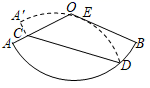

# Mathematics - 题目 2767

**ID**: 5dea83bbc45c490e9de595842ff41233
**年级**: Grade 9
**难度**: Medium-Hard
**题型**: Fill-in-the-blank

## 题目
如图，已知扇形AOB的圆心角为120°，点C是半径OA上一点，点D是弧AB上一点．将扇形AOB沿CD对折，使得折叠后的图形恰好与半径OB相切于点E．若∠OCD＝45°，OC＝ $\sqrt {3}$ +1，则扇形AOB的半径长是．​​​​​​​‌

## 解答

1. 解：作 $O$ 关于 $CD$ 的对称点 $F$ ，连接 $CF$ 、 $EF$ ，如图1所示：
2. 
3. 则 $EF$ 为扇形 $AOB$ 的半径，
4. 由折叠的性质得： $\angle FCD=\angle OCD=45{}^\circ $ ， $FC=OC=\sqrt {3}+1$ ，
5. $\therefore \angle OCF=90{}^\circ $ ，
6. $\therefore ΔOCF$ 是等腰直角三角形，
7. $\therefore \angle COF=45{}^\circ $ ， $OF=\sqrt {2}OC=\sqrt {6}+\sqrt {2}$ ，
8. $\therefore \angle EOF=\angle AOB-\angle COF=75{}^\circ $ ，
9. $\because $ 折叠后的图形恰好与半径 $OB$ 相切于点 $E$ ，
10. $\therefore \angle OEF=90{}^\circ $ ，
11. $\therefore \angle OFE=15{}^\circ $ ，
12. $\because {\cos}\angle OFE=\frac {EF}{OF}={\cos}15{}^\circ =\frac {\sqrt {6}+\sqrt {2}}{4}$ ，如图2所示：
13. 
14. $\therefore EF=OF\times {\cos}15{}^\circ =(\sqrt {6})\times \frac {\sqrt {6}+\sqrt {2}}{4}=2+\sqrt {3}$ ；
15. 故答案为： $2+\sqrt {3}$ ．

## 知识点

**中文**:
  - 余弦
  - 等腰三角形的判定与性质
  - 切线的性质定理
  - 折叠问题

**English**:
  - Cosine
  - Determination and Properties
  - Tangent Properties Theorem
  - Folding Problems

---
