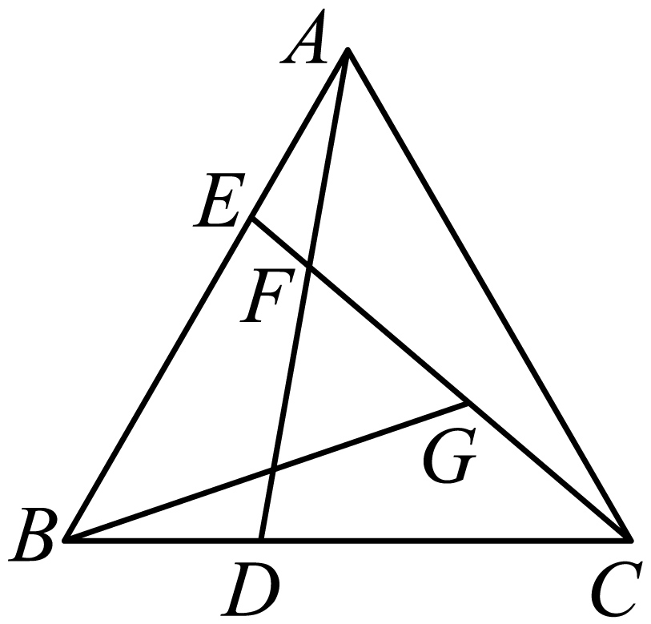

# Mathematics - 题目 3726

**ID**: 60a9e7d2ecad454f854d6c75ea07130d
**年级**: Grade 9
**难度**: Medium-Hard
**题型**: Fill-in-the-blank

## 题目
如图，等边三角形 $ABC$ 边长为  $2，$ 点D在 $BC$ 边上，且 $BD<CD$ ， 点E在 $AB$ 边上， 连接 $AD$ ， $CE$ 交于点F， 若 $\angle AEC+\angle ADC=180{}\degree $ ， 在线段 $FC$ 上截取 $FG=FA$ ， 连接 $BG$ ， 则线段 $BG$ 的最小值是．​​​​​​​‌

## 解答

1. 解：∵等边三角形 $ABC$ ，
2. ∴ $AB=AC,\angle ABC=\angle BAC=60{}\degree $ ，
3. ∵ $\angle AEC+\angle ADC=180{}\degree $ ，
4. 又∵ $\angle ADB+\angle ADC=180{}\degree $ ,
5. ∴ $\angle AEC=\angle ADB$ ，
6. ∴ $\angle AEC=\angle ADB$ ， $\angle ABC=\angle BAC,AB=AC$ ，
7. ∴ $\mathrm{△}ABD{\rm{≌}}\mathrm{△}CAE$ ，
8. ∴ $∠BAD=\angle ACE$ ，
9. ∴ $\angle AFE=\angle FAC+\angle ACE=\angle FAC+\angle FAE=\angle BAC=60{}\degree $ ，
10. 连接 $AG$ ，如图，
11. ∵ $FG=FA$ ，
12. ∴ $\angle FAG=\angle FGA=30{}\degree $ ，
13. ∴ $\angle AGC=150{}\degree $ ，
14. ∴点G在以 $AC$ 为弦、所对圆周角为 $150{}\degree $ 的一段弧上运动，
15. 设这段弧所在的圆心为O，连接 $AO,CO,BO,GO$ ，如图，
16. 则 $BG+OG\geqslant OB$ （当且仅当 $B,G,O$ 三点共线时取 $=$ ），
17. ∴ $BG$ 的最小值即为 $BO-OG$ ，
18. 
19. 设 $BO,AC$ 交于点H，
20. ∵ $\angle AGC=150{}\degree $ ，
21. ∴ $\angle AOC=2\times \left ({180{}\degree -150{}\degree }\right )=60{}\degree $ ，
22. ∵ $AO=CO$ ，
23. ∴ $\mathrm{△}ACO$ 是等边三角形，
24. ∴ $AO=CO=AC=AB=BC=2$ ，
25. ∴四边形 $ABCO$ 是菱形，
26. ∴ $AC\bot BO,AH=\frac {1}{2}AC=1,BH=OH,\angle ABH=\frac {1}{2}\angle ABC=30{}\degree $ ，
27. ∴ $BH=\sqrt {2{^{2}}-1{^{2}}}=\sqrt {3}$ ，
28. ∴ $BO=2\sqrt {3}$ ，
29. ∴ $BG$ 的最小值为 $2\sqrt {3}-2$ ；
30. 故答案为； $2\sqrt {3}-2$ ．

## 知识点

**中文**:
  - 圆周角定理
  - 等边三角形的判定与性质
  - 菱形的判定与性质综合

**English**:
  - Inscribed Angle Theorem
  - Determination and Properties
  - Determination and Properties of Rhombuses

---
