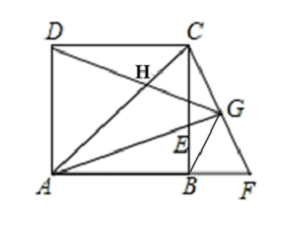

# Mathematics - 题目 2427

**ID**: 629bb578eb29424eaeb51b7260d8b188
**年级**: Grade 9
**难度**: Medium-Hard
**题型**: Fill-in-the-blank

## 题目
如图，ABCD为正方形，∠CAB的角平分线交BC于点E，过点C作CF⊥AE交AE的延长线于点G，CF与AB的延长线交于点F，连接BG、DG、与AC相交于点H，则下列结论：① $Δ$ ABE $\cong $  $Δ$ CBF；​​​​​​​‌②GF=CG；③BG⊥DG；④ $DH=(\sqrt {2}-1)AE$ ，其中正确的是．

## 解答

1. ∵四边形ABCD为正方形，∴AB=BC，∠ABC=∠CBF=90°
2. ∴∠BAE+∠AEB=90°
3. ∵AG⊥CF
4. ∴∠BCF+∠CEG=90°
5. ∵∠BEA=∠CEG
6. ∴∠BAE=∠BCF
7. ∴ $Δ$ ABE $\cong $  $Δ$ CBF，故①正确；
8. ∵AG平分∠FAC，AE⊥CF
9. ∴∠CAG=∠FAG，∠AGC=∠AGF=90°
10. 又∵AG=AG，∴ $Δ$ ACG $\cong $  $Δ$ AFG.
11. ∴CG=FG，故②正确；
12. 延长DG，AB交于点M，在 $Δ$ DCG和 $Δ$ MFG中，∠DCG=∠MFG，FG=CG，∠MGF=∠DGC
13. $Δ$ DCG $\cong $  $Δ$ MFG
14. ∴DG=MG，FM=DC=AB
15. ∴AF=BM．
16. ∵AF=AC，∴BM=AC=BD
17. ∴BG⊥DG，故③正确；
18. ∵∠CDH=∠CAE，∠DCH=∠ACE
19. ∴ $�$ DCH $\sim �$ ACE
20. ∴ $\frac {DH}{AE}$ = $\frac {DC}{AC}$ = $\frac {1}{\sqrt {2}}$ .
21. ∴AE= $\sqrt {2}$ DH，故④不正确.
22. 故答案为：①②③

## 知识点

**中文**:
  - 正方形的判定与性质综合
  - 相似三角形的判定与性质综合

**English**:
  - Determination and Properties of Squares
  - Determination and Properties

---
