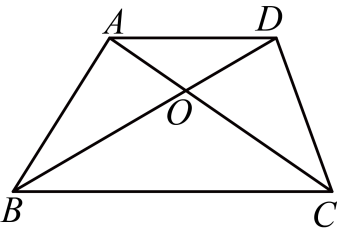

# Mathematics - 题目 2172

**ID**: 640e4eb6dbe94cc2a9587426da42c9f5
**年级**: Grade 9
**难度**: Medium-Hard
**题型**: Fill-in-the-blank

## 题目
如图，在四边形 $ABCD$ 中， $AD\mathrm{/\mskip-4mu/}BC,{\rm{c}}{\rm{o}}{\rm{s}}∠BCD=\frac {1}{3}$ ， $AC$ 与 $BD$ 交于点 $O$ ， $BO=2DO$ ， $OC=320$ ，则 $BC+CD$ 的最大值．​​​​​​​‌

## 解答

1. 解：∵ $AD\mathrm{/\mskip-4mu/}BC$ ，
2. ∴ $\vartriangle AOD∽\vartriangle COB$ ，
3. ∴ $\frac {AD}{BC}=\frac {OD}{BO}=\frac {AO}{CO}$ ，
4. ∵ $BO=2DO$ ，
5. ∴ $\frac {AD}{BC}=\frac {AO}{CO}=\frac {1}{2}$ ，
6. ∴ $BC+CD=2AD+CD=2\left ({AD+\frac {1}{2}CD}\right )$ ，
7. 又∵ $OC=320$ ，
8. ∴ $AO=160$ ，
9. ∴ $AC=AO+OC=480$ ，
10. ∵ $AD\mathrm{/\mskip-4mu/}BC$ ，
11. ∴ $\angle ADC=180\mathrm{°}-\angle BCD$ ，
12. ∵ ${\rm{c}}{\rm{o}}{\rm{s}}∠BCD=\frac {1}{3}$ ，
13. ∴ $\angle BCD$ 是定值，则 $∠ADC$ 也是定值，
14. 根据“定弦定角”模型可知，当 $AD+\frac {1}{2}CD$ 为圆的直径时，取得最大值，
15. 如图所示，过点 $C$ 作 $CE\bot AD$ 交 $AD$ 的延长于点 $E$ ，延长 $AE$ 至 $F$ ，使得 $EF=\frac {1}{2}DE$ ，
16. 设 $DE=2a$ ，则 $DC=\frac {DE}{{\cos}\angle CDE}=3DE=6a$ ， $DF=DE+EF=3a=\frac {1}{2}CD$ ，
17. ∴ $AD+\frac {1}{2}CD=AF$ ，
18. 
19. 在 ${\rm{R}}{\rm{t}}\mathrm{△}CDE$ 中， $CE=\sqrt {CD{^{2}}-DE{^{2}}}=\sqrt {{\left({6a}\right)^{2}}-{\left({2a}\right)^{2}}}=4\sqrt {2}a$ ，
20. 在 ${\rm{R}}{\rm{t}}\mathrm{△}CEF$ 中， $CF=\sqrt {CE{^{2}}+EF{^{2}}}=\sqrt {{\left({4\sqrt {2}a}\right)^{2}}+a{^{2}}}=\sqrt {33}a$ ，
21. ∴ $\sin F=\frac {CE}{CF}=\frac {4\sqrt {2}a}{\sqrt {33}a}=\frac {4\sqrt {66}}{33}$ ，
22. ∴当 $AF$ 为过点 $A,C$ 的圆的直径时， $AF$ 取得最大值，
23. 此时，如图所示，
24. 
25. ∵ $AF$ 为直径，
26. ∴ $\angle ACF=90{}\degree $ ，
27. ∴ $AF=\frac {AC}{\sin F}=\frac {480}{\frac {4\sqrt {66}}{33}}=60\sqrt {66}$ ，
28. ∴ $BC+CD=2AD+CD=2\left ({AD+\frac {1}{2}CD}\right )=120\sqrt {66}$ ，
29. ∴ $BC+CD$ 的最大值为 $120\sqrt {66}$ ．

## 知识点

**中文**:
  - 圆周角定理
  - 相似三角形的判定与性质综合
  - 解直角三角形

**English**:
  - Inscribed Angle Theorem
  - Determination and Properties
  - Solving Right Triangles

---
