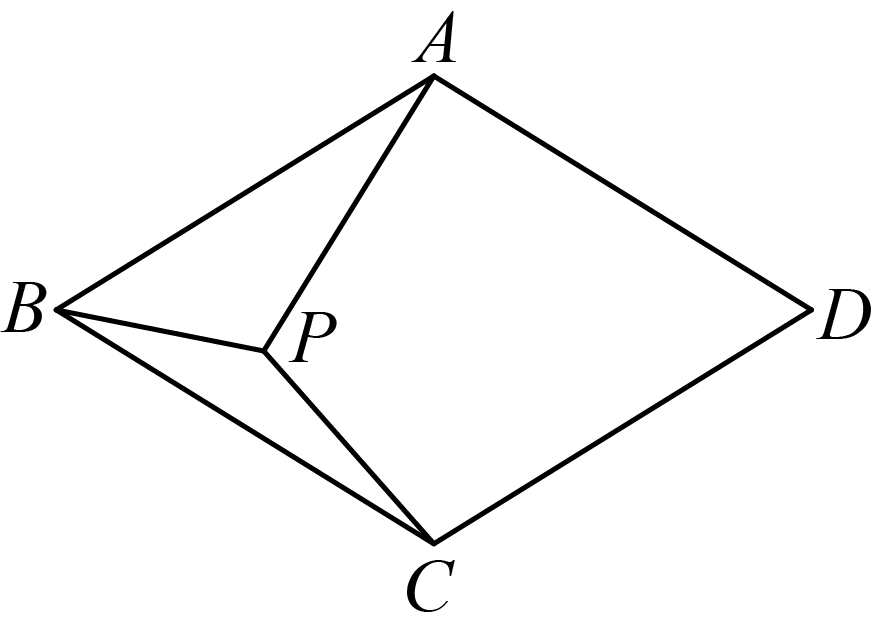

# Mathematics - 题目 2713

**ID**: 65743c15ccff45ce9b9e5447ddaf0723
**年级**: Grade 9
**难度**: Medium-Hard
**题型**: Fill-in-the-blank

## 题目
如图，菱形 $ABCD$ 中， ${\rm{t}}{\rm{a}}{\rm{n}}\angle D=\frac {24}{7}$ ，若点P是菱形内一点，且 $PA=10，PB=5$ ， $PC=8$ ，则菱形 $ABCD$ 的边长为．​​​​​​​‌

## 解答

1. 解：如图，将 $\mathrm{△}PBC$ 逆时针旋转至 $△MBA$ ，连接 $MP$ 与 $AB$ 交于点O，过点M作 $MH\bot BP$ ，垂足为H，过点B作 $BN\bot MP$ ，垂足为N，
2. $\because $ 四边形 $ABCD$ 为菱形，
3. $\therefore $ 旋转角 $\angle MBP=\angle ABC=\angle D$ ， $AB=BC$ ，
4. $\therefore BM=BP=5$ ， ${\tan}\angle MBP={\tan}\angle D=\frac {24}{7}$ ，
5. $\therefore \frac {MH}{BH}=\frac {24}{7}$ ，
6. 设 $MH=24x$ ，则 $BH=7x$ ，
7. $\therefore BM=\sqrt {{\left({24x}\right)^{2}}+{\left({7x}\right)^{2}}}=25x=5$ ，
8. $\therefore x=\frac {1}{5}$ ，
9. $\therefore BH=\frac {7}{5}$ ， $MH=\frac {24}{5}$ ， $HP=5-\frac {7}{5}=\frac {18}{5}$ ，
10. 在 ${\rm{R}}{\rm{t}}△MHP$ 中， $MP=\sqrt {{\left({\frac {24}{5}}\right)^{2}}+{\left({\frac {18}{5}}\right)^{2}}}=6$ ，
11. $\because AP=10，AM=8$ ，
12. $\therefore $ 在 $\vartriangle AMP$ 中， $AM{^{2}}+MP{^{2}}=64+36=AP{^{2}}$ ，
13. $\therefore \vartriangle AMP$ 为直角三角形，
14. $\therefore \angle AMO=90{}\degree $ ，
15. $\because BM=BP，BN\bot MP$ ，
16. $\therefore MN=PN=\frac {1}{2}MP=3$ ，
17. $\therefore BN=\sqrt {BM{^{2}}-MN{^{2}}}=4$ ，
18. $\because \angle AMO=\angle BNO=90{}\degree $ ，
19. $\therefore AM{\rm{/\mskip-4mu/}}BN$ ，
20. $\therefore \mathrm{△}AMO∽\mathrm{△}BNO$ ，
21. $\therefore \frac {AM}{BN}=\frac {OM}{ON}=\frac {AO}{BO}=\frac {8}{4}$ ，
22. 设 $OM=y$ ，则 $ON=3-y$ ，
23. $\therefore \frac {y}{3-y}=\frac {8}{4}$ ，
24. 解得： $y=2$ ，
25. $\therefore OM=2，ON=1$ ，
26. 在 ${\rm{R}}{\rm{t}}\mathrm{△}AOM$ 中，
27. $AO=\sqrt {AM{^{2}}+MO{^{2}}}=\sqrt {8{^{2}}+2{^{2}}}=2\sqrt {17}$ ，
28. $\because \frac {AO}{BO}=\frac {8}{4}$ ，
29. $\therefore BO=\sqrt {17}$ ，
30. $\therefore AB=AO+BO=3\sqrt {17}$

## 知识点

**中文**:
  - 勾股定理的逆定理
  - 旋转的性质
  - 相似三角形的判定与性质综合

**English**:
  - Converse of Pythagorean Theorem
  - Properties of Rotation
  - Determination and Properties

---
