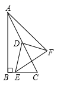

# Mathematics - 题目 679

**ID**: 65a41cd5e50742bb94703f12b7e78aa0
**年级**: Grade 9
**难度**: Medium-Hard
**题型**: Fill-in-the-blank

## 题目
如图，在 $Rt\vartriangle ABC$ 中， $\angle ABC=90{}^\circ $ ， $\angle BAC=30{}^\circ $ ， $BC=4$ ，点 $D$ 是 $AC$ 边的中点， $E$ 是直线 $BC$ 上一动点，将线段 $DE$ 绕点 $D$ 逆时针旋转90°得到线段 $DF$ ，连接 $AF$ 、 $EF$ ，在点 $E$ 的运动过程中线段 $AF$ 的最小值为．​​​​​​​‌

## 解答

1. 解：如图，作DM⊥BC于M，FJ⊥DM于J交AB于N，则四边形BMJN是矩形，
2. ∵Rt△ABC中，∠ABC＝90°，∠BAC＝30°，BC＝4，
3. ∴AC＝2BC＝8，AB＝ $\sqrt {3}$ BC＝4 $\sqrt {3}$ ，
4. ∵AD＝DC，DM∥AB，
5. ∴DM＝ $\frac {1}{2}$ AB＝2 $\sqrt {3}$ ，BM＝CM＝2，
6. ∵四边形BMJN是矩形，
7. ∴JN＝BM＝2，
8. ∵∠FDJ＋∠EDM＝90°，∠EDM＋∠DEM＝90°，
9. ∴∠FDJ＝∠DEM，
10. ∵∠FJD＝∠DME＝90°，
11. ∴△FJD≌△DME（AAS），
12. ∴FJ＝DM＝2 $\sqrt {3}$ ，
13. ∴FN＝FJ＋JN＝2＋2 $\sqrt {3}$ ，
14. ∴点F在直线l上运动（直线l与直线AB之间的距离为2 $\sqrt {3}$ ＋2），
15. 根据垂线段最短可知，当AF⊥直线l时，AF的值最短，最小值为2 $\sqrt {3}$ ＋2，
16. 故答案为2 $\sqrt {3}$ ＋2．
17. 

## 知识点

**中文**:
  - 全等三角形的综合问题
  - 垂线段最短
  - 几何变换——旋转综合题
  - 解直角三角形

**English**:
  - Comprehensive Problems
  - Shortest Perpendicular Segment
  - Rotation Comprehensive Problems
  - Solving Right Triangles

---
