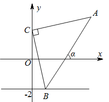

# Mathematics - 题目 570

**ID**: 6c01df7bd3ea4b5f885ebc9472dae034
**年级**: Grade 9
**难度**: Medium-Hard
**题型**: Fill-in-the-blank

## 题目
如图，已知点 $A(4,3)$ ，点 $B$ 为直线 $y=-2$ 上的一动点，点 $C(0,n)$ ， $-2<n<3$ ， $AC\bot BC$ 于点 $C$ ，连接 $AB$ ．若直线 $AB$ 与 $x$ 正半轴所夹的锐角为 $α$ ，那么当 ${\sin}α$ 的值最大时， $n$ 的值为．​​​​​​​‌

## 解答

1. 解：如图，设直线y＝﹣2与y轴交于G，过A作AH⊥直线y＝﹣2于H，AF⊥y轴于F，
2. 
3. ∵BH∥x轴，
4. ∴∠ABH＝α，
5. 在Rt△ABH中， $AB=\sqrt {AH{^{2}}+BH{^{2}}}$  , ${\sin}α$  $=\frac {5}{BA}$ ，
6. 即 ${\sin}α$  $=\frac {5}{BA}$ = $\frac {5}{\sqrt {AH{^{2}}+BH{^{2}}}}$
7. ∵sinα随BA的减小而增大，
8. ∴当BA最小时sinα有最大值；即BH最小时，sinα有最大值，即BG最大时，sinα有最大值，
9. ∵∠BGC＝∠ACB＝∠AFC＝90°，
10. ∴∠GBC+∠BCG＝∠BCG+∠ACF＝90°，
11. ∴∠GBC＝∠ACF，
12. ∴△ACF∽△CBG，
13. ∴ $\frac {BG}{CF}=\frac {CG}{AF}$ ，
14. ∵ $A(4,3)$ ， $C(0,n)$
15. 即 $\frac {BG}{3-n}=\frac {n+2}{4}$ ，
16. ∴BG$=-\frac {1}{4}$ （n+2）（3﹣n） $=-\frac {1}{4}$ （n$-\frac {1}{2}$ ）^{2}$+\frac {25}{16}$ ，
17. ∵ $-2<n<3$
18. ∴当n$=\frac {1}{2}$ 时，BG最大值 $=\frac {25}{16}$
19. 故答案为： $\frac {1}{2}$ ．

## 知识点

**中文**:
  - 正弦
  - 相似三角形的判定与性质综合

**English**:
  - Sine
  - Determination and Properties

---
