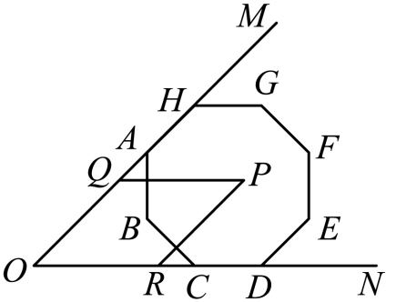

# Mathematics - 题目 516

**ID**: 6e0a5c8439d74a4281eede5edb18299c
**年级**: Grade 9
**难度**: Medium-Hard
**题型**: Fill-in-the-blank

## 题目
如图，点 $P$ 是边长为 $2$ 的正八边形 $ABCDEFGH$ 围成的区域（包括各边）内的一点，分别延长边 $HA$ 和边 $DC$ 相交于点 $O$ ，点 $R,Q$ 分别在射线 $ON$ 和 $OM$ 上，过点 $P$ 分别作 $PQ\mathrm{/\mskip-4mu/}ON$ 交 $OM$ 于点 $Q$ ， $PR\mathrm{/\mskip-4mu/}OM$ 交 $ON$ 于点 $R$ ．设 $OR=a$ ， $OQ=b$ ，令 $t=a+\sqrt {2}b$ ，则 $t$ 的取值范围是．​​​​​​​‌

## 解答

1. 解：∵点 $P$ 是边长为 $2$ 的正八边形 $ABCDEFGH$ 围成的区域（包括各边）内的一点，
2. ∴正八边形的每个内角的度数为 $\frac {180{}\degree \times \left ({8-2}\right )}{8}=135{}\degree $ ，
3. 如图所示，连接 $AC$ ，过点 $Q$ 作 $QI⊥OC$ 于点 $I$ ，过点 $P$ 作 $PJ⊥OC$ 于点 $J$ ，延长 $AB$ 交 $ON$ 于点 $K$ ，过点 $B$ 作 $BS\mathrm{/\mskip-4mu/}ON,BT\mathrm{/\mskip-4mu/}OM$ ，
4. 
5. ∴ $\angle BAC=\angle BCA=\frac {1}{2}\left ({180{}\degree -\angle ABC}\right )=\frac {1}{2}\times \left ({180{}\degree -135{}\degree }\right )=22.5{}\degree $ ， $∠OAB=180{}\degree -∠BAH=180{}\degree -135{}\degree =45{}\degree =∠OCB$ ，
6. ∴ $∠OAC=∠OCA=∠OAB+∠BAC=45{}\degree +22.5{}\degree =67.5{}\degree $ ，
7. ∴ $OA=OC$ ，
8. ∴ $∠AOC=180{}\degree -2∠OAC=180{}\degree -2\times 67.5{}\degree =45{}\degree $ ，
9. ∵ $BS\mathrm{/\mskip-4mu/}ON,BT\mathrm{/\mskip-4mu/}OM$ ，
10. ∴四边形 $OTBS$ 是平行四边形，
11. ∴ $OT=BS,OS=BT$ ， $∠O=∠BTC=∠BCT=∠BSA=∠BAS=45{}\degree $ ，
12. ∴ $△ABS,△BCT$ 是等腰直角三角形，
13. ∴ $AB=BS=BT=BC=2$ ，
14. ∵ $PQ\mathrm{/\mskip-4mu/}OC,PR\mathrm{/\mskip-4mu/}OA$ ，
15. ∴四边形 $PQOR$ 是平行四边形，
16. ∴ $PQ=OR=a,OQ=PR=b$ ，
17. ∵ $∠O=45{}\degree ,QI⊥ON$ ，
18. ∴ $∠OQI=45{}\degree ,OI=QI$ ， $\sin ∠QOI=\sin 45{}\degree =\frac {QI}{OQ}=\frac {\sqrt {2}}{2}$ ，
19. ∴ $QI=\frac {\sqrt {2}}{2}OQ=\frac {\sqrt {2}}{2}b=OI$ ，
20. ∵ $∠QOI=∠PRJ=45{}\degree ,∠QIO=∠PJC=90{}\degree ,OQ=RP$ ，
21. ∴ $\vartriangle OQI≌\vartriangle RPJ\left ({{\rm{A}}{\rm{A}}{\rm{S}}}\right )$ ，
22. ∴ $RJ=JP=OI=QI=\frac {\sqrt {2}}{2}b$ ，
23. ∵ $∠AOC=∠OAB=45{}\degree =∠BCK=∠CBK$ ， $AB=BC=2$ ，
24. ∴ $△OAK,△BCK$ 是等腰直角三角形，
25. ∴ $CK=BK=\frac {\sqrt {2}}{2}$ ， $AK=OK=AB+BK=2+\frac {\sqrt {2}}{2}=\frac {4+\sqrt {2}}{2}$ ，
26. 当点 $P$ 与点 $B$ 重合时，
27. 
28. ∴ $OR=PQ=AB=a=2$ ， $OQ=PR=b=\sqrt {2}BK=\sqrt {2}\times \frac {\sqrt {2}}{2}=1$ ，
29. ∴ $t=a+\sqrt {2}b=2+\sqrt {2}\times 2=2+2\sqrt {2}$ ；
30. 当点 $P$ 与点 $F$ 重合时，
31. 
32. 同理， $∠PRJ=EDJ=45{}\degree ,∠O=∠PQM=45{}\degree $ ， $PJ⊥ON,QI⊥ON,AK⊥ON$ ，
33. ∴点 $Q$ 与点 $\mathrm{A}$ 重合，点 $I$ 与点 $K$ 重合，点 $C$ 与点 $R$ 重合，
34. ∴ $OR=PQ=a=OK+KR=2+\sqrt {2}+\sqrt {2}=2+2\sqrt {2}$ ， $OQ=PR=b=\sqrt {2}AK=\sqrt {2}\times \left ({2+\sqrt {2}}\right )=2\sqrt {2}+2$ ，
35. ∴ $t=a+\sqrt {2}b=\left ({2+2\sqrt {2}}\right )+\sqrt {2}\times \left ({2\sqrt {2}+2}\right )=6+4\sqrt {2}$ ；
36. 当点 $P$ 与点 $G$ 重合时，
37. 
38. 同理，点 $Q$ 与点 $H$ 重合，点 $I$ 与点 $C$ 重合，点 $J$ 与点 $D$ 重合，点 $T$ 与点 $R$ 重合，
39. ∴ $PH=OT=a=2,OQ=PT=b=\sqrt {2}PJ=\sqrt {2}HC=\sqrt {2}\times \left ({2+2\sqrt {2}}\right )=2\sqrt {2}+4$ ，
40. ∴ $t=a+\sqrt {2}b=2+\sqrt {2}\times \left ({2\sqrt {2}+4}\right )=6+4\sqrt {2}$ ；
41. ∴ $2+2\sqrt {2}\leqslant t\leqslant 6+4\sqrt {2}$ ．

## 知识点

**中文**:
  - 正多边形的概念和性质
  - 解直角三角形

**English**:
  - Regular Polygons Concepts
  - Solving Right Triangles

---
