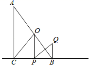

# Mathematics - 题目 2998

**ID**: 70ca8b6c063441788e7d7c16cfa00aea
**年级**: Grade 9
**难度**: Medium-Hard
**题型**: Fill-in-the-blank

## 题目
如图所示，在Rt△ABC中，∠ACB＝90°，∠A＝30°，点O为AB中点，点P为直线BC上的动点（不与B、C重合），连接OC、OP，将OP绕点P顺时针旋转60°，得到线段PQ，连接BQ，若∠BPO＝15°，BP＝4，则BQ的长为．​​​​​​​‌

## 解答

1. 依题意，分以下两种情况：
2. ①如图1，当点P在CB延长线上时，连接OQ
3. $\because Rt\mathrm{Δ}ABC$ 中，点O为AB中点
4. $\therefore OC=OB$
5. $\because \angle A=30{}^\circ $
6. $\therefore \angle ABC=60{}^\circ $
7. ∴△OBC是等边三角形
8. $\therefore \angle BOC=60{}^\circ $
9. ∵OP绕点P顺时针旋转 $60{}^\circ $ ，得到线段PQ
10. ∴△OPQ是等边三角形
11. $\therefore OP=OQ,\angle QOP=\angle OQP=\angle OPQ=60{}^\circ $
12. $\therefore \angle COP=\angle BOQ$
13. 在△COP和△BOQ中， $\begin{cases}OC=OB\\\angle COP=\angle BOQ\\OP=OQ\end{cases}$
14. $\therefore \Delta COP\cong \Delta BOQ(SAS)$
15. $\therefore \angle OQB=\angle BPO=15{}^\circ $
16. $\therefore \angle BQP=\angle OQP-\angle OQB=60{}^\circ -15{}^\circ =45{}^\circ $
17. $\therefore \angle QBP=180{}^\circ -\angle BQP-\angle OPQ-\angle BPQ=180{}^\circ -45{}^\circ -60{}^\circ -15{}^\circ =60{}^\circ $
18. 过点P作PD⊥BQ于D，则 $\angle DPB=30{}^\circ $
19. $\therefore BD=\frac {1}{2}BP=2,DP=\sqrt {BP{^{2}}-BD{^{2}}}=2\sqrt {3}$
20. $\because \angle DQP=45{}^\circ $
21. ∴△QDP是等腰直角三角形
22. $\therefore DQ=DP=2\sqrt {3}$
23. $\therefore BQ=BD+DQ=2+2\sqrt {3}$ ；
24. ②如图2，当点P在BC延长线上时，连接OQ
25. $\because Rt\mathrm{Δ}ABC$ 中，点O为AB中点
26. $\therefore OC=OB$
27. $\because \angle A=30{}^\circ $
28. $\therefore \angle ABC=60{}^\circ $
29. ∴△OBC是等边三角形
30. $\therefore \angle OBC=\angle BOC=\angle OCB=60{}^\circ $
31. $\therefore \angle OCP=120{}^\circ $
32. ∵OP绕点P顺时针旋转 $60{}^\circ $ ，得到线段PQ
33. ∴△OPQ是等边三角形
34. $\therefore OP=OQ,\angle OPQ=\angle POQ=60{}^\circ $
35. $\therefore \angle COP=\angle BOQ$
36. 在△COP和△BOQ中， $\begin{cases}OC=OB\\\angle COP=\angle BOQ\\OP=OQ\end{cases}$
37. $\therefore \Delta COP\cong \Delta BOQ(SAS)$
38. $\therefore \angle OBQ=\angle OCP=120{}^\circ $
39. $\therefore \angle PBQ=\angle OBQ-\angle OBC=120{}^\circ -60{}^\circ =60{}^\circ $
40. $\because \angle BPO=15{}^\circ $
41. $\therefore \angle BPQ=\angle OPQ-\angle BPO=60{}^\circ -15{}^\circ =45{}^\circ $
42. 过点Q作QE⊥BP于E，则 $\angle BQE=30{}^\circ $
43. 设 $BQ=x$ ，则 $BE=\frac {1}{2}x$
44. $\therefore QE=\sqrt {BQ{^{2}}-BE{^{2}}}=\frac {\sqrt {3}}{2}x$
45. $\because \angle BPQ=45{}^\circ $
46. $\therefore PE=QE=\frac {\sqrt {3}}{2}x$
47. $\therefore BP=BE+PE=\frac {1}{2}x+\frac {\sqrt {3}}{2}x=4$
48. 解得 $x=4\sqrt {3}-4$ ，即 $BQ=4\sqrt {3}-4$
49. 综上，BQ的长为 $2+2\sqrt {3}$ 或 $4\sqrt {3}-4$
50. 故答案为： $2+2\sqrt {3}$ 或 $4\sqrt {3}-4$ ．
51. 

## 知识点

**中文**:
  - 全等三角形实际应用
  - 等边三角形的判定与性质
  - 旋转的性质

**English**:
  - Applications of Congruent Triangles
  - Determination and Properties
  - Properties of Rotation

---
