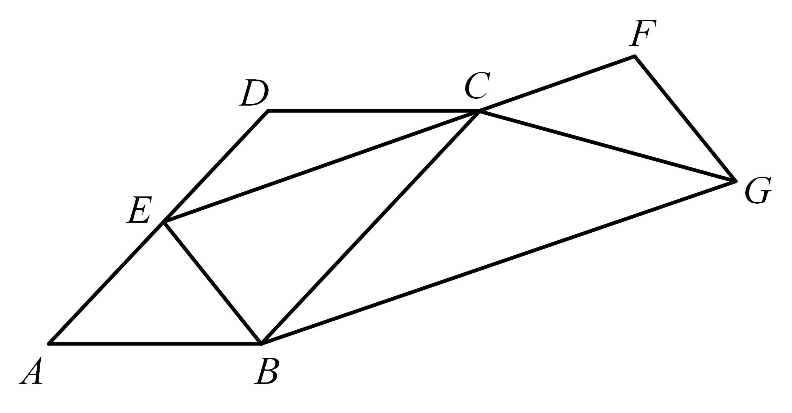

# Mathematics - 题目 2074

**ID**: 71f827ea46f34c0da024f8d541300947
**年级**: Grade 9
**难度**: Medium-Hard
**题型**: Fill-in-the-blank

## 题目
如图，在 $▱ABCD$ 中， $AB=4$ ， $AD=6$ ， $\angle A=45{}\degree $ ，点 $E$ 为边 $AD$ 上的一个动点，连接 $EC$ 并延长至点 $F$ ，使得 $CF=\frac {1}{2}CE$ ，以 $EB$ ， $EF$ 为邻边构造 $▱BEFG$ ，连接 $CG$ ，则 $CG$ 的最小值为．​​​​​​​‌

## 解答

1. 如图，延长 $GC$ 交 $AD$ 的延长线于点M，连 $EG$ 交 $AC$ 于点O，
2. 
3. ∵ $CF=\frac {1}{2}CE$ ，
4. ∴ $CE=\frac {2}{3}EF=\frac {2}{3}BG$
5. ∵四边形 $BEFG$ 为平行四边形，
6. ∴ $EF\parallel BG$ ， $EF=BG$ ，
7. ∴ $\vartriangle EOC∽\vartriangle GOB$ ，
8. ∴ $\frac {EC}{BG}=\frac {EO}{OG}=\frac {2}{3}$ ，
9. ∵四边形 $ABCD$ 为平行四边形，
10. ∴ $AD\mathrm{/\mskip-4mu/}BC$ ， $AB/\mskip-4mu/CD$ ， $AB=CD=4$ ,
11. ∴ $\frac {CM}{GC}=\frac {EO}{OG}=\frac {2}{3}$ ，
12. ∴ $GC=\frac {3}{2}CM$ ，
13. ∴当 $CM$ 取最小值时，此时 $CG$ 最小，
14. 由“直线外一点与直线上各点连接的所有线段中，垂线段最短”知，
15. $CM\bot DM$ 时， $CM$ 取最小值，
16. ∵ $AB/\mskip-4mu/CD$ ，
17. ∴ $\angle A=\angle CDM=45{}\degree $ ，
18. ∴ $\angle CDM=\angle MCD=45{}\degree $ ，
19. ∴ $CM=DM$ ，
20. ∵ $CM{^{2}}+DM{^{2}}=DC{^{2}}$ ，
21. ∴ $CM=DM=\sqrt {4{^{2}}\div 2}=2\sqrt {2}$ ，
22. ∴ $CG=\frac {3}{2}CM=\frac {3}{2}\times 2\sqrt {2}=3\sqrt {2}$ .
23. 【点晴】本题主要考查了平行四边形的性质，相似三角形的判定和性质，平行线截线段成比例定理，垂线段最短，等腰直角三角形的判定和性质，勾股定理等知识点，熟练掌握其性质，合理添加辅助线是解决此题的关键．

## 知识点

**中文**:
  - 垂线段最短
  - 平行四边形的对边平行且相等
  - 平行线分线段成比例定理
  - 相似三角形的判定与性质综合

**English**:
  - Shortest Perpendicular Segment
  - Opposite Sides Parallel and Equal
  - Parallel Lines Intercept Theorem
  - Determination and Properties

---
